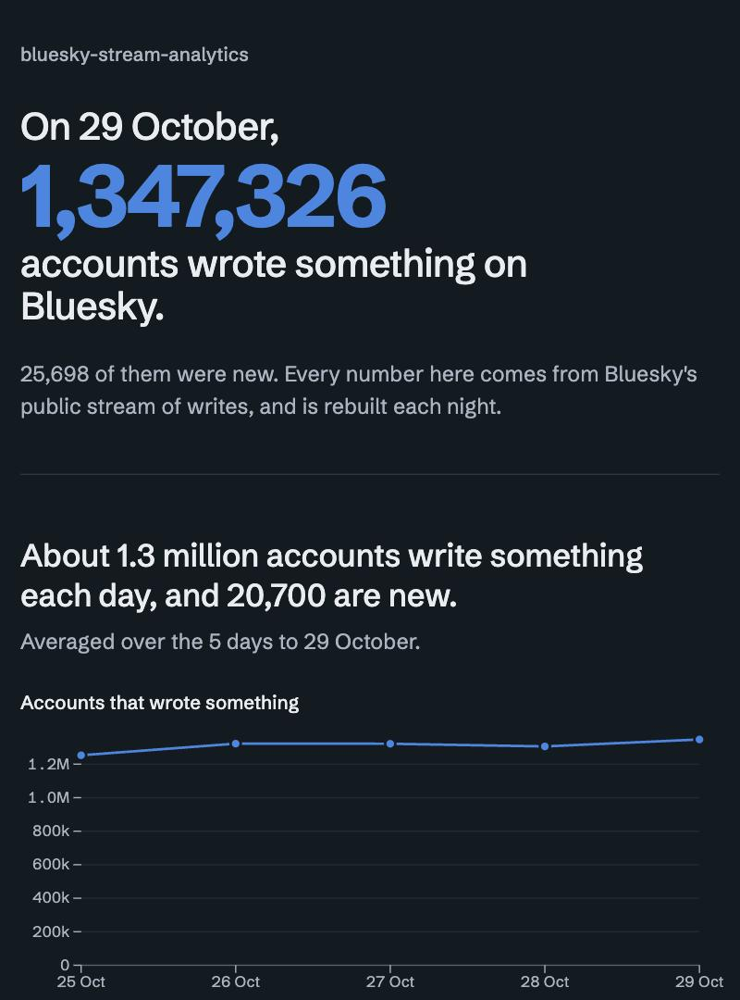
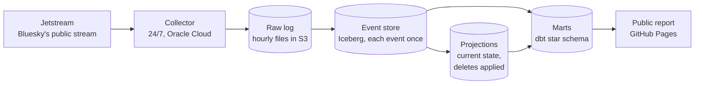

# Bluesky Stream Analytics

[](https://github.com/dhirajkk91/bluesky-stream-analytics/actions/workflows/ci.yml)
[](https://github.com/dhirajkk91/bluesky-stream-analytics/actions/workflows/dashboard.yml)

A data pipeline that collects every public write on Bluesky around the clock, keeps each event exactly once in an Iceberg event store, honors deletes on a stated schedule, and models the result as a Kimball star schema of product metrics. The metrics are published every morning as a public report.

**Live report: [dhirajkk91.github.io/bluesky-stream-analytics](https://dhirajkk91.github.io/bluesky-stream-analytics/)**



## Key findings

From the first week of data. The live report keeps them current.

- **About 1.3 million accounts write something on Bluesky each day**, and about 20,000 new accounts appear.
- **Engagement is concentrated.** The top 1% of the accounts that receive any likes, reposts or replies receive half of them. The Gini coefficient of engagement received is 0.88.
- **Attention is short.** A third of a day's engagement goes to posts less than an hour old, and half to posts under three hours old.
- **Most new accounts don't return.** About one in five writes anything the day after it appears.

## Architecture



The source is a stream of changes, so the pipeline is event-sourced rather than organized as bronze, silver and gold layers. The event log is the source of truth, and every other table is derived from it and can be rebuilt by replaying it ([why](docs/decisions/engineering-decisions.md#d-018-event-sourced-not-medallion)).

| Layer | What it holds | How it changes | Built with |
|---|---|---|---|
| Raw log | Every event as received, duplicates included | Appended continuously, expires after 14 days | Python (asyncio), S3 |
| Event store | Each distinct event once, typed, no post text | Appended hourly; rewritten only to redact deleted records | DuckDB, Apache Iceberg, AWS Glue |
| Projections | What exists now: posts, likes, reposts, follows and blocks | New versions and delete markers appended hourly, compacted nightly | DuckDB, Iceberg, Athena |
| Marts | Facts and dimensions for product metrics, including account history (SCD type 2) | The last two days rebuilt nightly | dbt on Athena |
| Public report | Totals only, with small groups suppressed | Exported nightly, published each morning | GitHub Actions, GitHub Pages, Observable Plot |

## Engineering highlights

- **No lost events across crashes and reboots.** The collector syncs to disk before saving its position, and resumes slightly before it after a restart. In a kill test, 20,000 events were sent with the process killed mid-run, and all 20,000 were saved. A deliberate server reboot resumed and caught up within a minute ([collector](docs/architectures/collector.md)).
- **Exactly-once event store.** Each hour is deduplicated on load and merged only into the hours its events fall in, so reloading the same files adds nothing. A check against the raw files matches hour by hour ([event store](docs/architectures/event-store.md)).
- **Engine chosen by measurement.** The hourly job was first written in Spark. On a real hour, DuckDB produced identical output in 11 seconds against Spark's 82, so the job runs on DuckDB ([benchmark](docs/decisions/engineering-decisions.md#d-025-duckdb-for-the-hourly-job)). Column profiling then cut the table from 77 bytes per event to 31.
- **Order-independent current state.** Projections are folded incrementally from new Iceberg commits. The highest revision wins and deletes leave markers, so replayed and out-of-order events give the same answer. A full recount from the event store matched every record type exactly ([projections](docs/architectures/projections.md)).
- **Deletes honored on a schedule, within budget.** A deleted record is hidden from every query in about 80 minutes and physically removed from S3 on tiered deadlines. The tiers come from measuring how old records are when they're deleted, which brings the projected compaction cost to about $2 a month at six months of data, against about $25 for a full nightly pass ([deletion policy](docs/architectures/compaction.md)).
- **Kimball modeling with late and missing data.** An SCD type 2 account dimension, inferred-member placeholders for replies to posts that were never seen, and incremental facts that rebuild a two-day window for late events. 14 models and 32 data tests run on every build ([marts](docs/architectures/marts.md)).
- **No long-lived keys outside the server.** The publishing workflow reaches AWS through GitHub's OIDC provider, with a role that can read a single file, and nothing on AWS is public ([report](docs/architectures/dashboard.md)).
- **Monitoring that has already paid off.** Every job reports to an external dead man's switch, failures email the end of their log, and a health check watches for a stalled stream, backlogs and disk space. On its first day it found a nightly job that had never been scheduled ([monitoring](docs/architectures/monitoring.md)).
- **Tested at every layer.** 149 automated tests, including a fake Jetstream server, a fake S3, slow-disk simulations, and the dbt models built on DuckDB against hand-computed results. Every pull request also validates the Terraform ([testing](docs/validation/testing.md)).

## In numbers

| | |
|---|---|
| Accounts writing something each day | about 1.3 million |
| Writes per day (posts, likes, reposts, follows, blocks, deletes) | about 32 million |
| Time until a deleted record is hidden | about 80 minutes on average |
| Event store size per event | 31 bytes |
| Infrastructure | one Oracle Cloud Always Free server, and AWS within a $10 monthly budget |
| Automated tests | 149 |

## Tech stack

| Area | Tools |
|---|---|
| Ingestion | Python 3.14, asyncio, websockets, zstd |
| Storage | Amazon S3, Apache Iceberg, AWS Glue Data Catalog |
| Processing | DuckDB (hourly), Amazon Athena (nightly); Spark benchmarked |
| Modeling | dbt Core with dbt-athena; dbt-duckdb in CI |
| Infrastructure | Terraform, Oracle Cloud, systemd |
| Delivery and operations | GitHub Actions (CI, Pages, OIDC), healthchecks.io |
| Report | HTML, CSS, Observable Plot |

## Data principles

- Only public data is collected, and the project never interacts with anyone on the network.
- Only totals are published. Nothing about an individual account or post leaves the pipeline, and groups smaller than 100 are folded into "other" or left out.
- Deletes are honored. A deleted record is hidden from everything within about 2 hours, and physically removed within 2 days if it was deleted soon after being created, otherwise within 8 days (posts and reposts) or 32 days (likes, follows and blocks) ([why it's tiered](docs/architectures/compaction.md#why-its-tiered)).
- Post text exists only in the raw log, which expires after 14 days.

## Schedule

| When (UTC) | Job | What it does |
|---|---|---|
| Continuously | `collect` | Reads Jetstream and writes hourly files |
| Every 10 minutes | `upload` | Uploads finished hourly files to S3 |
| Every 10 minutes | `check-health` | Checks the newest event, backlogs and disk space |
| Hourly at :20 | `process`, `project`, `resolve-handles` | Loads the event store, folds the projections, looks up changed handles |
| 03:45 | `compact` | Redacts deleted records and compacts the tables |
| 04:30 | `dbt build`, `export-dashboard` | Builds and tests the marts, exports the report's numbers |
| 05:45 | `compact --vacuum` | Removes the files compaction replaced |
| 06:17 | Dashboard workflow | Publishes the report |

## Repository layout

```
src/bluesky_stream_analytics/   collector, uploader, event store, projections, compaction, handle lookups, export, monitoring
transform/                      dbt project: staging, intermediate and mart models, tests, portable macros
sql/                            Athena views and data checks
site/                           the public report
infra/aws/                      Terraform for S3, IAM, Glue, Athena, the budget and the OIDC role
deploy/                         systemd units and environment file templates
benchmarks/                     Spark against DuckDB
tests/                          automated tests
docs/                           architecture, decisions, validation
```

## Running it

Requires [uv](https://docs.astral.sh/uv/).

```bash
uv run pytest                     # run the tests
uv run watch                      # live summary of the stream every 10 seconds, nothing saved
uv run collect                    # save every event under ./data
uv run upload --bucket <bucket>   # copy finished hourly files to S3
```

```bash
uv run process --catalog local --database events.duckdb      # load data/uploaded/ into a local DuckDB table
uv run process --warehouse s3://<bucket>/warehouse           # the same, into the Iceberg table in Glue
uv run fetch-raw --bucket <bucket> --date 2026-10-24         # download a day of raw files to load again
uv run project --warehouse s3://<bucket>/warehouse           # fold new event-store commits into the projections
uv run compact --warehouse s3://<bucket>/warehouse           # the night's compaction and redaction, in Athena
uv run resolve-handles --warehouse s3://<bucket>/warehouse   # look up handles for new identity changes
uv run dbt build --project-dir transform --profiles-dir transform   # build and test the marts in Athena (needs BUCKET)
uv run export-dashboard --out site/data/dashboard.json      # the report's numbers, from the marts
uv run python -m http.server -d site 8000                   # then the report at localhost:8000
uv run check-health --data-dir /var/lib/bluesky             # what the 10-minute health check sees
uv run --group bench python benchmarks/compare_engines.py <raw files>   # Spark against DuckDB, needs Java 17 or 21
```

The AWS resources are defined in `infra/aws/`. Terraform also saves the SQL in `sql/` as named queries in the `bluesky-stream-analytics` Athena workgroup.

## Roadmap

- **Orchestration with Airflow.** Run the hourly and nightly jobs as DAGs, so each waits for the one before it instead of starting at a fixed time, with retries and backfills.
- **A real-time path with Kafka.** Publish the stream to a topic, with a consumer counting trending hashtags and languages minute by minute alongside the nightly batch.
- **Containers.** Package every job as a Docker image.
- **The first month's analysis,** once day-30 retention is available.

## Documentation

**Architecture**
- [End-to-end pipeline](docs/architectures/end-to-end-pipeline.md): how the pieces fit together
- [Collector](docs/architectures/collector.md): saving every event and surviving crashes
- [Uploader](docs/architectures/uploader.md): getting files safely into S3
- [Event store](docs/architectures/event-store.md): the hourly job and the table with every event once
- [Projections](docs/architectures/projections.md): current posts, likes, reposts, follows and blocks, with deletes applied
- [Compaction](docs/architectures/compaction.md): the deletion policy, and the nightly job that keeps it
- [Handle lookups](docs/architectures/handles.md): resolving handles through Bluesky's API, since the feed doesn't carry them
- [Marts](docs/architectures/marts.md): the star schema, and how each metric is defined
- [Dashboard](docs/architectures/dashboard.md): the public report
- [Monitoring](docs/architectures/monitoring.md): alerts when something breaks
- [Query layer](docs/architectures/query-layer.md): SQL with Athena
- [Infrastructure](docs/architectures/infrastructure.md): the Oracle server and the AWS resources

**Decisions**
- [Engineering decisions](docs/decisions/engineering-decisions.md): the reasoning behind each design choice, with the alternatives rejected

**Validation**
- [Testing](docs/validation/testing.md): automated tests, the kill test, production runs and data checks
- [CI](docs/validation/ci.md)
- [Incidents](docs/validation/incidents.md): what went wrong in production, and what changed because of it
