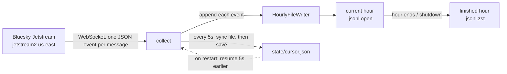

# Architecture

## Overview

Right now there are two commands, both running on my laptop:

- **`watch`** connects to Jetstream and prints a summary of what's flowing through every 10 seconds. Nothing is saved, its to check the stream
works or not
- **`collect`** connects to Jetstream and saves every event to disk, and can be killed at any point and restarted without leaving gaps.



## The source: Jetstream

Jetstream is a public WebSocket service run by Bluesky. It pushes every public action on the network as a JSON message: posts, likes, reposts, follows, profile changes, deletes, and account and identity changes.

Things about it that shape the design:

- Every event has `time_us`, the server's timestamp in microseconds. You can reconnect with `?cursor=<time_us>` and it replays from that point.
- Each Jetstream server stamps its own `time_us`, so a cursor from one server doesn't line up exactly on another. I connect to one fixed server.
- Delivery is at least once. Duplicates happen.
- `time_us` never went backwards in my first real run, but about 2% of events shared their `time_us` with the event before. It works as a resume point, not as an event ID.
- There's no sequence number, so there's no direct way to tell if an event was skipped.

## Code layout

```
src/bluesky_stream_analytics/
    watch.py     live summary view, nothing stored
    collect.py   connection loop, reconnects, shutdown, status logging
    writer.py    hourly files, compression, crash recovery
    cursor.py    loads and saves the resume point
    fs.py        small helper for durable renames
tests/
    test_cursor.py, test_writer.py, test_collect.py
```

## How `collect` works

### Start-up

1. **Recover.** Looks for files left behind by a run that didn't shut down cleanly and finish them (details below).
2. **Pick a resume point.** It's the newer of two things: the saved cursor, and the newest event found in recovered files. The second matters because events written after the last cursor save are still sitting in the file.
3. **Connect.** With a resume point, connect with `?cursor=` set 5 seconds before it. Without one, start from live.

### While running

- Each message is parsed just enough to read `time_us`, then the raw text is appended to the current hour's file exactly as received.
- Every 5 seconds a background task forces the file onto disk (`fsync`) and **then** saves the cursor. Doing it in that order means the cursor can never point past data that isn't on disk.
- Every 60 seconds it logs events received, events per second, and how far behind live the newest event is.

### When the connection drops

It waits and reconnects, resuming from the newest event already written, minus the 5-second rewind. The wait doubles each attempt (1s, 2s, 4s, up to 60s) and is randomized within each step. It resets after a successful connection.

### Shutdown

Ctrl+C or `SIGTERM` cancels the connection, finishes the current file, and saves the final cursor.

## Data on disk

Everything goes under `data/` (ignored by git):

```
data/
├── events/
│   └── date=****-**-**/
│       ├── hour=13/
│       │   └── 1761224400123456_3f9a1c2e.jsonl.zst    finished, never modified again
│       └── hour=14/
│           └── 1761228000004211_3f9a1c2e.jsonl.open   hour in progress
└── state/
    └── cursor.json                                     {"time_us": 1761228012345678}
```

- **Format.** JSON Lines: one raw event per line, exactly as Jetstream sent it.
- **Folders.** `date=…/hour=…` is the Hive partition style. Later, when this is in S3, a query engine like Athena can read only the hours it needs instead of scanning everything.
- **File names.** The `time_us` of the file's first event, plus a random id per collector run, so two runs never write to the same file.
- **Which folder an event lands in.** It's based on the event's `time_us`, but a file only moves forward in time. A replayed event from the previous hour goes into the current file instead of reopening a finished one. Anything reading these files should use each event's `time_us`, not the folder name.

### A file's life

1. During its hour, events are appended to `<name>.jsonl.open`, uncompressed.
2. When the first event of a later hour arrives, or on shutdown:
   - it's compressed with zstd to `<name>.jsonl.zst.tmp`
   - synced to disk
   - renamed to `<name>.jsonl.zst`
   - and the `.open` file is deleted.
3. If the process dies before that, the next start-up recovers it:
   - a `.zst.tmp` is an unfinished compression, so it's deleted;
   - an `.open` whose `.zst` already exists means the crash came after compression, so the `.open` is deleted;
   - any other `.open` gets its half-written last line cut off, then goes through step 2.

Appending uncompressed until the hour is over means a crash can only ever damage the last line of a file.

## What's guaranteed and what isn't

| | |
|---|---|
| An event that was synced to disk is never lost | Yes |
| Restarting doesn't leave a gap | Yes, as long as the resume point is still inside Jetstream's replay window |
| No duplicates | No. Every reconnect replays about 5 seconds on purpose. They'll be removed in a later step |
| Every event Bluesky produced is captured | Can't tell yet. Jetstream has no sequence numbers |
| Runs 24/7 | No, it runs on my laptop for now |

## How it's tested

- **Unit tests** cover:
  - the cursor (save, load, missing file, corrupt file)
  - the writer (rotation, compression, crash recovery, partial lines)
  - the reconnect delay
- **End-to-end tests** run `Collector` against a fake Jetstream server on localhost that honours `?cursor=` like the real one. They cover:
  - collecting everything
  - a dropped connection
  - a restart from the saved cursor
  - resuming from recovered data that's newer than the cursor
- **Kill test, done by hand.** I ran the real `collect` command against the fake server three times:
  - killed with `SIGKILL` before its first cursor save
  - killed with `SIGKILL` again after cursor saves
  - stopped with `SIGTERM`

  The server sent 20,000 events in total. All 20,000 were saved, none were missing, and 6,862 lines were duplicates from the rewinds. That run also found a gap bug, which is fixed now.
