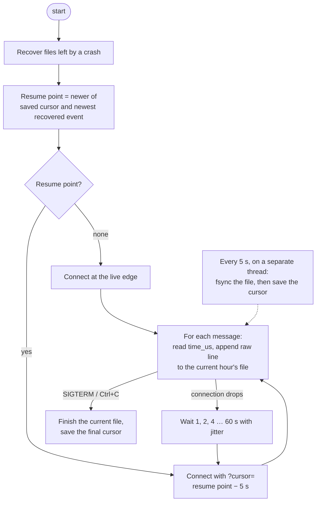
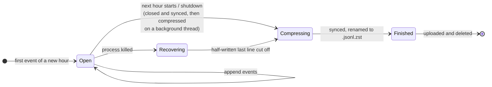

# Collector

## Purpose

`collect` keeps a connection open to Jetstream and saves every event to hourly files on disk. It can be killed at any moment, by a crash, a reboot or a deploy, and the next start picks up where it left off without a gap.

## Goals and non-goals

Goals:

- Store every event exactly as received, so later layers can always be rebuilt from the raw files.
- Never lose an event that was written to disk, whatever point the process dies at.
- Resume after any stop without a gap, accepting a few seconds of duplicates to get there.

Non-goals:

- Removing duplicates, parsing records or handling deletes. Later layers do that from the raw files.
- Failing over to another Jetstream server. Cursors don't line up across servers.

## Design



1. **Recover.** Files left behind by a run that didn't shut down cleanly are finished first (see [A file's life](#a-files-life)).
2. **Pick a resume point.** The newer of the saved cursor and the newest event found in recovered files. The second matters because events written after the last cursor save are still in the file.
3. **Connect.** With a resume point, connect with `?cursor=` set 5 seconds before it. Without one, start from live.
4. **Write.** Each message is parsed just enough to read `time_us`, then the raw text is appended to the current hour's file.
5. **Checkpoint.** Every 5 seconds the main loop hands the buffered events to the operating system, and a separate thread forces them onto disk and only then saves the cursor, so the cursor can never point past data that isn't on disk. The main loop keeps reading events while the disk catches up, which matters when another job is keeping the disk busy ([D-027](../decisions/engineering-decisions.md#d-027-sync-to-disk-on-its-own-thread)).
6. **Status.** Every 60 seconds it logs events received, the rate, how far behind live it is, the longest sync and the longest pause of the main loop in that minute. A sync over 1 second, or the main loop being blocked for 2 seconds or more, is logged as a warning straight away.
7. **Reconnect.** If the connection drops, it waits (doubling up to 60 seconds, randomized within each step) and resumes from the newest event already written, minus the rewind. The wait resets after a successful connection.
8. **Shut down.** `SIGTERM` or Ctrl+C cancels the connection, waits for a sync in progress, finishes the current file and saves the final cursor.

## What is stored

```text
<data dir>/
├── events/
│   └── date=YYYY-MM-DD/
│       ├── hour=13/
│       │   └── 1761224400123456_3f9a1c2e.jsonl.zst    finished, never modified again
│       └── hour=14/
│           └── 1761228000004211_3f9a1c2e.jsonl.open   hour in progress
└── state/
    └── cursor.json                                     {"time_us": 1761228012345678}
```

- **Format.** JSON Lines: one raw event per line, exactly as Jetstream sent it.
- **Folders.** `date=…/hour=…` is the Hive partition layout, so Athena can read only the hours a query needs.
- **File names.** The `time_us` of the file's first event plus a random id per collector run, so two runs never write to the same file.
- **Which folder an event lands in.** It follows the event's `time_us`, but a file only moves forward in time. A replayed event from the previous hour goes into the current file instead of reopening a finished one. Readers should use each event's `time_us`, not the folder.

## A file's life



1. During its hour, events are appended to `<name>.jsonl.open`, uncompressed.
2. When the next hour starts, or on shutdown, the file is flushed, synced and closed on the main loop, so its events are on disk before anything else happens. A background thread then compresses it to `<name>.jsonl.zst.tmp`, syncs it, renames it to `<name>.jsonl.zst` and deletes the `.open` file. The main loop keeps reading events meanwhile; on shutdown it waits for the compression to finish.
3. If the process dies before that, the next start-up recovers it:
   - a `.zst.tmp` is an unfinished compression, so it's deleted;
   - an `.open` whose `.zst` already exists means the crash came after compression, so the `.open` is deleted;
   - any other `.open` gets its half-written last line cut off, then goes through step 2.

Appending uncompressed until the hour is over means a crash can only ever damage the last line of a file.

## Failure handling

| What happens | Result |
|---|---|
| Process killed mid-write | Recovery keeps every complete line, drops the partial one, and resumes from the newest saved event minus 5 seconds |
| Killed before the first cursor save | No cursor yet, but recovery finds the newest event in the file and resumes from there |
| Connection drops | Reconnects with backoff, resuming from the newest written event. How often drops happen, and a pattern in when, is in [testing](../validation/testing.md#connection-drops-and-heavy-jobs) |
| Cursor file unreadable | Stops with an error instead of starting from live, which would leave a gap |
| Unreadable message (no `time_us`) | Skipped and counted in the status log |
| Disk slow to sync, for example while another job is busy with it | The sync waits on its own thread while events keep being read. Slow syncs and any pause of the main loop are logged |
| Compression fails (for example, disk full) | The collector stops with the error and saves its cursor. systemd restarts it, and recovery compresses the leftover `.open` file |
