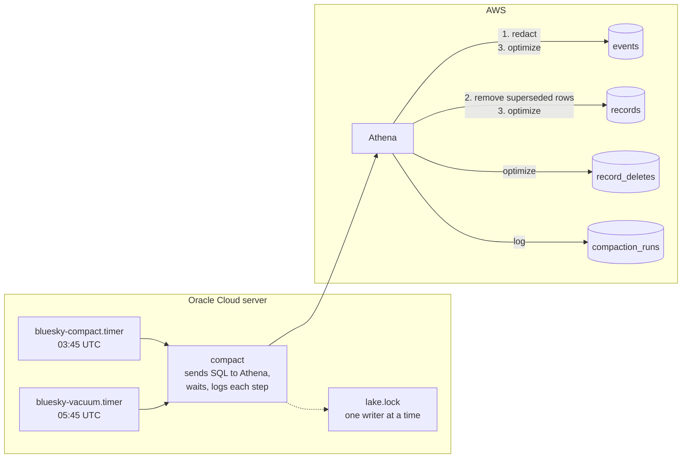

# Compaction

## Purpose

The [projections](projections.md) only ever append, which keeps the hourly run cheap but leaves three kinds of leftovers:

- **Deleted records.** The `current_records` view hides them within about 2 hours, but their rows, with what a deleted like pointed at, are still in the files. So are the events that created them in the [event store](event-store.md).
- **Old versions** of edited posts.
- **Small files**: every hourly run writes a few per record type, around 120 a day.

Compaction cleans these up, and with it, deletes on Bluesky become deletes in this project's storage too, by a stated deadline.

## The deletion policy

| | Posts and reposts | Likes, follows and blocks |
|---|---|---|
| Hidden from every view and query | within 2 hours | within 2 hours |
| Physically removed, record deleted within a day of being created | within 2 days | within 2 days |
| Physically removed, any age | within 8 days | within 32 days |

Every delete is honored, whatever the record's age. What differs is how soon its bytes leave S3. The views hide deleted records long before that, so the schedule decides storage, not what anyone can see. Bluesky's [developer guidelines](https://docs.bsky.app/docs/support/developer-guidelines) require a way to delete content a user asked to delete and set no deadline; the deadlines are this project's own.

## Why it's tiered

Removing a row means finding it, and Athena charges by bytes read. Measured on the real tables ([details](../validation/testing.md#compaction-measured-by-hand)), a compaction that reaches the whole `records` table read it about three times over: 9 GB for a table of 2.6 GB, about 5 cents. The table grows by about 1 GB a day, so compacting all of it every day would cost around $25 a month within three months, more than the project's whole $10 budget.

The age of a record when it's deleted decides how far back each run needs to reach, and that was measured too, over 2.5 million deletes:

| Age of the record when deleted | Share of deletes |
|---|---|
| under a day | 36.6% |
| 1 to 7 days | 15.7% |
| 7 to 31 days | 10.6% |
| over a month | 37.1% |

So `records` is partitioned by the day each record was created, and compaction runs at three reaches:

| Tier | When | Posts and reposts | Likes, follows and blocks |
|---|---|---|---|
| Daily | every night but the ones below | created in the last 3 days | created in the last 3 days |
| Weekly | Sunday nights | everything | created in the last 8 days |
| Monthly | the 1st of the month | everything | everything |

The daily run catches over a third of all deletes, the quick unlikes and unfollows, for a few cents. Posts carry more than likes (reply links, languages) and are about a tenth of the rows, so they get the full pass every week. Likes, follows and blocks are nine tenths of the table and get it once a month. At six months of data that's roughly $2 a month, against about $25 for a full daily pass.

**Rejected:** ignoring deletes that come long after the record was created. It would cost nothing, but it breaks the project's ground rule and Bluesky's guidelines, and leaves counts like current follows wrong: over a third of deletes are of records more than a month old.

## Design

For each group of record types, within the tier's reach:

1. **Redact the event store.** For every row of `records` that a newer delete hides, blank `subject_did`, `subject_collection`, `subject_rkey`, `reply_parent_uri`, `reply_root_uri` and `langs` in the store event that created or edited it, matched on its key, revision and exact event time ([D-034](../decisions/engineering-decisions.md#d-034-deleted-records-are-redacted-in-the-event-store)). This runs first because `records` holds the event time of each version, which tells Athena which hour of the store to read.
2. **Remove superseded rows.** Delete every row of `records` with a newer delete or a newer version of the same record. After this, `records` holds exactly one row per current record within the reach.
3. **Optimize.** Athena changes rows by writing small delete files that mask them; the original rows are still in the data files until those are rewritten. So the files of `records` and of the event store with even one delete file are rewritten, and small files merged. Then `record_deletes` is optimized.

One row per step goes into `compaction_runs`: when, the tier, the step and its reach, seconds, bytes scanned, and whether it succeeded.

**The projections skip compaction's commits.** Redacting and rewriting add new files to the event store, holding events that are already folded. The projections job reads the store's Iceberg metadata, and only folds files from commits that are appends; compaction's commits are overwrites and replaces.

Two hours later, `compact --vacuum` runs `VACUUM` on `records`, `record_deletes` and `events`. Every table keeps an hour of snapshots, so by then the snapshots from before compaction have expired, and the files only they referred to are deleted. That's the moment a deleted record's data is gone from S3.

**Delete markers stay.** They're what stops a create replayed from a backfill from bringing a deleted record back ([D-031](../decisions/engineering-decisions.md#d-031-the-highest-rev-wins-and-deletes-leave-a-marker)). They hold only the key, `rev` and time.

## One writer at a time

Compaction and the hourly job commit to the same tables. Two writers committing to an Iceberg table at once means one of them fails. Both run on the server, so both take the same file lock first (`flock /var/lib/bluesky/lake.lock`), and one waits for the other ([D-035](../decisions/engineering-decisions.md#d-035-one-writer-at-a-time)).

## Measuring time-to-forget

- **Hidden:** each projection run logs `oldest_delete_time`, the oldest delete it folded. `run_at - oldest_delete_time` is the longest a deleted record stayed visible.
- **Physically removed:** `compaction_runs` logs when each tier ran and what it reached, and when each vacuum finished. A delete is gone once the first compaction reaching its record's creation day, and the vacuum after it, have both run.

## Failure handling

| What happens | Result |
|---|---|
| A step fails | The run stops there and logs the failed step. Every step is safe to run again, so the next night's run picks up the rest |
| The run is skipped (server down) | The timer runs it when the server is back. A missed daily run is covered by the next one, which reaches 3 days back |
| The hourly job is running | Compaction waits for the lock, and the other way round |
| Redaction rewrites store files | The projections skip those commits. If one were folded anyway, its rows would only duplicate ones already there, which the views ignore |

## Limits

- **Exact duplicate rows**, which only a crash between appending and logging a projection run can create, aren't removed. The views ignore them.
- **If the projections job is down for the two hours between compaction and the vacuum**, the vacuum expires compaction's commits before the job has seen them, and the job can no longer tell they were rewrites. It would then fold the rewritten files again: duplicates the views ignore, but that compaction doesn't remove.
- **The monthly run grows with the data.** At about $1 a month at six months, that's fine for now. Past a year, the full pass for likes could move to every second month.

## Cost

Measured on the first runs and logged in `compaction_runs` from then on. The estimate above is about $2 a month at six months of data.
