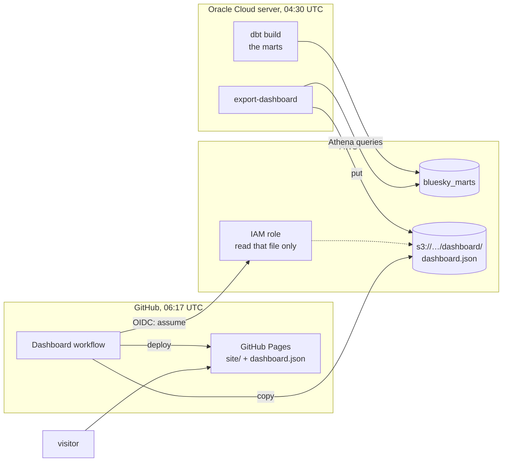

# Dashboard

## Purpose

One public page that says what the stream shows, in totals, with the caveats beside the numbers. It's at `https://dhirajkk91.github.io/bluesky-stream-analytics/`.

## Goals and non-goals

Goals:

- Only totals leave the project. Nothing about any account or post, and small groups folded away.
- Updated every morning, with no one touching it.
- Free, and nothing on AWS open to the internet.
- Each finding written from the data, so the words never go stale while the numbers move.

Non-goals:

- Exploring the data: filters, drill-downs, custom date ranges. It's a report, not a tool.
- Real time. The marts are daily, so the page is too.
- Live queries. A visitor never reaches Athena.

## Design



1. **Export.** Right after the marts build, in the same service, `export-dashboard` runs five small Athena queries and writes one JSON file, a few tens of kilobytes, to `dashboard/dashboard.json` in the project's bucket. The bucket stays private.
2. **Publish.** Every morning at 06:17 UTC, and whenever `site/` changes, a GitHub Actions workflow copies that file into `site/data/` and deploys `site/` to GitHub Pages.
3. **Read.** The page is plain HTML, CSS and one script. It loads `data/dashboard.json` from its own site and draws the charts with [Observable Plot](https://observablehq.com/plot/).

**No AWS key in GitHub.** The workflow gets credentials for one run from GitHub's OIDC provider: AWS trusts tokens that GitHub signs for this repository's Pages deployments, and the role they get can read that one file and nothing else ([D-042](../decisions/engineering-decisions.md#d-042-the-dashboard-is-a-static-page-with-the-data-baked-in)).

## What it shows

| Section | From | Over |
|---|---|---|
| Accounts that wrote something, and new accounts | `mart_daily_metrics` | every whole day; the heading averages the last 7 |
| Writes by kind | `mart_daily_metrics` | an average day in the last 7 |
| Share of engagement going to the top 1%, and the Gini coefficient | `mart_daily_metrics` | every whole day |
| Engagement by the age of the post, in hours | `mart_engagement_by_post_age` | the last 7 days, summed |
| Day 1, 7 and 30 retention by signup day | `mart_retention` | every signup day |
| Posts by language | `mart_posts_by_language_daily` | the last 7 days, summed |
| How long deletes stay visible | `projection_runs` | the last 168 hourly runs |

The first day of collection began partway through, so it's left out of the charts and averages; the export marks it `partial`.

**Small groups.** A signup day with fewer than 100 new accounts isn't shown, and a language with fewer than 100 posts a day is folded into "other". At Bluesky's size neither has happened yet, but the rule is in the export, not the page, so a small group never leaves the server.

## The page

- **Each heading is the finding,** computed from the data: "34% of likes, reposts and replies go to posts less than an hour old". So it stays true as the numbers move, and a reader gets the point without reading the chart.
- **Caveats sit in the margin,** next to the chart they qualify, as they do in the [marts](marts.md#the-metrics-defined) doc. On a phone they drop below the chart.
- **One color for the data,** with grey for what's context: the posts past the half-way hour, "other" and untagged languages. Colors come from a palette checked for color blindness, with its own steps for dark mode.
- **Every chart has a hover tooltip** with the exact number, and every series is named in its title, never by color alone.

## Failure handling

| What happens | Result |
|---|---|
| The export fails | The marts service fails, and monitoring emails within a minute. The page keeps yesterday's numbers |
| The workflow fails | GitHub emails the repository owner. The page keeps yesterday's numbers |
| The export ran late | The page shows the date it's "updated" and the last whole day, so stale numbers are visible as stale |
| The JSON can't be loaded | The page says so, instead of drawing empty charts |

## Previewing locally

```
uv run export-dashboard --out site/data/dashboard.json
uv run python -m http.server -d site 8000
```

Then open `http://localhost:8000`. The export needs AWS credentials that can run Athena queries; `site/data/` is ignored by git.

## Cost

Free. GitHub Pages and Actions are free for public repositories. The export's Athena queries read the small mart tables, a few megabytes a night, well under a cent.
