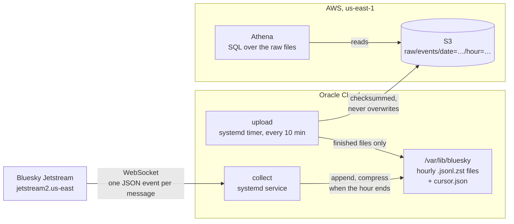

# End-to-end pipeline

## Purpose

The pipeline turns Bluesky's public Jetstream feed into raw hourly files in S3, collected nonstop. Everything later (clean tables, metrics, the dashboard) is built from those files, so this layer's job is to capture every event and never lose one. Each part has its own document:

- [Collector](collector.md): connecting, writing hourly files, resuming after a crash
- [Uploader](uploader.md): moving finished files to S3
- [Query layer](query-layer.md): SQL on the raw files with Athena
- [Infrastructure](infrastructure.md): the Oracle server and the AWS resources

## Design



1. **Collect.** `collect` keeps one WebSocket open to a fixed Jetstream server and appends every event, exactly as received, to the current hour's file. Every 5 seconds it syncs the file to disk and then saves its position. After a crash it repairs any half-written file and resumes 5 seconds before its last saved position.
2. **Finish the hour.** When an event from the next hour arrives, the current file is compressed with zstd and becomes read-only from then on.
3. **Upload.** Every 10 minutes `upload` sends each finished file to S3 under the same path, with a checksum S3 verifies, and deletes the local copy only after S3 confirms.
4. **Query.** Athena reads the files in place through a Glue table, so every uploaded hour can be explored with SQL straight away.

There is also `watch`, which prints a live summary of the stream and saves nothing. It's for checking the feed from any machine.

## The source: Jetstream

Jetstream is a public WebSocket service run by Bluesky. It pushes every public action on the network as a JSON message: posts, likes, reposts, follows, profile changes, deletes, and account and identity changes.

Things about it that shape the design:

- Every event has `time_us`, the server's timestamp in microseconds. Reconnecting with `?cursor=<time_us>` replays from that point.
- Each Jetstream server stamps its own `time_us`, so a cursor from one server doesn't line up exactly on another. The collector uses one fixed server.
- Delivery is at least once, so duplicates happen.
- `time_us` never went backwards in the first real run, but about 2% of events shared their `time_us` with the event before. It works as a resume point, not as an event ID.
- There's no sequence number, so there's no direct way to tell if an event was skipped.

## What's guaranteed and what isn't

| | |
|---|---|
| An event synced to disk is never lost | Yes |
| A restart doesn't leave a gap | Yes, as long as the resume point is still inside Jetstream's replay window |
| No duplicates | No. Every resume replays about 5 seconds on purpose. They'll be removed in a later layer |
| Every event Bluesky produced is captured | Can't tell yet. Jetstream has no sequence numbers |
| A local file is deleted before S3 has it | Never |
| Runs 24/7 | Yes. systemd restarts the collector after a crash and starts it after a reboot |

## Code layout

```text
src/bluesky_stream_analytics/
    watch.py     live summary view, nothing stored
    collect.py   connection loop, reconnects, shutdown, status logging
    writer.py    hourly files, compression, crash recovery
    cursor.py    loads and saves the resume point
    upload.py    copies finished files to S3, then deletes them locally
    fs.py        helper for durable renames
tests/           unit and end-to-end tests
infra/aws/       Terraform for the bucket, the uploader's IAM user, the budget, the Glue table and the Athena workgroup
sql/             the events view and the check queries
deploy/systemd/  service and timer units for the server
```
