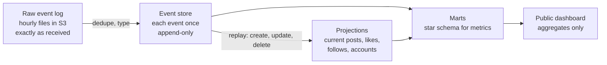
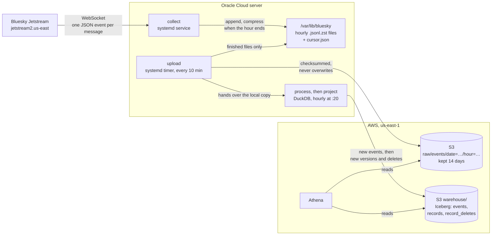

# End-to-end pipeline

## Purpose

The pipeline turns Bluesky's public Jetstream feed into an event log collected nonstop, and builds everything else from that log. Capturing every event and never losing one comes first. Each part has its own document:

- [Collector](collector.md): connecting, writing hourly files, resuming after a crash
- [Uploader](uploader.md): moving finished files to S3
- [Event store](event-store.md): the hourly DuckDB job that keeps every event exactly once
- [Projections](projections.md): current posts, likes, reposts, follows and blocks, with deletes applied
- [Compaction](compaction.md): the nightly Athena job that physically removes deleted records, and the deletion policy
- [Marts](marts.md): the star schema the metrics come from, built with dbt
- [Handle lookups](handles.md): asking Bluesky's API for handles, since the feed doesn't carry them
- [Query layer](query-layer.md): SQL on the raw files and the event store with Athena
- [Infrastructure](infrastructure.md): the Oracle server and the AWS resources

## Architecture

The project is **event-sourced**. Jetstream is already a log of events: every post, like or follow exists only because a create happened, maybe an update, maybe a delete. So the log of those events is the source of truth, and every other table is derived from it and can be rebuilt by replaying it.



| Part | What it is | Changes how | Status |
|---|---|---|---|
| Raw event log | Every event exactly as Jetstream sent it, duplicates included | Append only, expires after 14 days | Built |
| Event store | Each event once, typed, no record content | Append only, never updated | Built |
| Projections | What exists right now, with deletes applied | New versions and delete markers appended each hour, the latest picked by views | Built |
| Marts | Kimball star schema: facts like engagement, dimensions like accounts with full history (SCD type 2) | Rebuilt nightly with dbt in Athena, the last two days each time | Accounts built, posts next |

Writes and reads are kept apart in the CQRS sense. The event store is shaped for appending what happened. The projections and marts are read models, each shaped for the questions asked of it, and any of them can be thrown away and rebuilt from the store.

**Why not bronze, silver and gold.** The medallion layout organizes data by how clean it is. That fits sources that arrive as snapshots or batches. Here the source is a stream of changes, and the important distinction is between *what happened* (events, never changed) and *what is true now* (state, which deletes must change). Event sourcing makes that the main boundary. It's also what makes honoring deletes clean: the log keeps that a delete happened, and every projection drops the deleted record. More in [D-018](../decisions/engineering-decisions.md#d-018-event-sourced-not-medallion).

**What it isn't.** Processing is hourly micro-batches from a replayable file log, not a stream processor, so this isn't a Kappa or Lambda architecture.

## Design



1. **Collect.** `collect` keeps one WebSocket open to a fixed Jetstream server and appends every event, exactly as received, to the current hour's file. Reading and writing run on separate threads joined by a queue, so a busy disk never holds up the connection. Every 5 seconds the writer syncs the file to disk and then saves its position. After a crash it repairs any half-written file and resumes 5 seconds before its last saved position.
2. **Finish the hour.** When an event from the next hour arrives, the current file is compressed with zstd and becomes read-only from then on.
3. **Upload.** Every 10 minutes `upload` sends each finished file to S3 under the same path, with a checksum S3 verifies. Only after S3 confirms does it move the local copy to `uploaded/` for processing.
4. **Process.** Every hour `process` loads the waiting files with DuckDB, removes duplicates, and appends the events the event store doesn't have yet. Then it deletes the local copies.
5. **Project.** Right after, `project` reads the store commits added since its last run and appends new record versions and delete markers to the projections. Then `resolve-handles` looks up the handles of accounts whose identity changed in those commits.
6. **Compact.** Every night `compact` has Athena redact deleted records in the event store, remove superseded rows from the projections and rewrite small files, reaching further back on Sundays and the 1st of the month. Two hours later, a vacuum deletes the files nothing refers to any more.
7. **Build the marts.** Every night `dbt build` turns the event store into facts, dimensions and the daily metrics, and runs their tests.
8. **Query.** Athena reads the raw files in place for checks, and the event store and the projections' views for everything else.

There is also `watch`, which prints a live summary of the stream and saves nothing. It's for checking the feed from any machine.

## The source: Jetstream

Jetstream is a public WebSocket service run by Bluesky. It pushes every public action on the network as a JSON message: posts, likes, reposts, follows, profile changes, deletes, and account and identity changes.

Things about it that shape the design:

- Every event has `time_us`, the server's timestamp in microseconds. Reconnecting with `?cursor=<time_us>` replays from that point.
- Each Jetstream server stamps its own `time_us`, so a cursor from one server doesn't line up exactly on another. The collector uses one fixed server.
- Delivery is at least once, so duplicates happen.
- `time_us` never went backwards in the first real run, but about 2% of events shared their `time_us` with the event before. It works as a resume point, not as an event ID.
- There's no sequence number, so there's no direct way to tell if an event was skipped.

## What's guaranteed and what isn't

| | |
|---|---|
| An event synced to disk is never lost | Yes |
| A restart doesn't leave a gap | Yes, as long as the resume point is still inside Jetstream's replay window |
| No duplicates in the raw files | No. Every resume replays about 5 seconds on purpose |
| No duplicates in the event store | Yes. Each event is inserted once, however many times it was delivered or loaded |
| Every event Bluesky produced is captured | Can't tell yet. Jetstream has no sequence numbers |
| A local file is deleted before S3 has it | Never |
| A local file is deleted before the event store has its events | Never |
| Runs 24/7 | Yes. systemd restarts the collector after a crash and starts it after a reboot |

## Code layout

```text
src/bluesky_stream_analytics/
    watch.py         live summary view, nothing stored
    collect.py       connection loop, reconnects, shutdown, status logging
    writer.py        hourly files, compression, crash recovery
    cursor.py        loads and saves the resume point
    upload.py        copies finished files to S3, then hands them to the processor
    process.py       hourly job: appends handed-over files to the event store
    event_store.py   the SQL that parses, de-duplicates and appends events
    projections.py   hourly job: folds new store commits into the projections
    handles.py       hourly job: looks up handles for identity changes
    compact.py       nightly job: compaction and redaction, run in Athena
    fetch_raw.py     downloads raw files from S3 for backfills
    fs.py            helper for durable renames
transform/           the dbt project for the marts
tests/               unit and end-to-end tests
infra/aws/           Terraform for the bucket, IAM users, the budget, Glue and Athena
sql/                 the views and the check queries
deploy/              systemd units and env file examples
benchmarks/          the Spark version of the transform, and the Spark against DuckDB comparison
```
