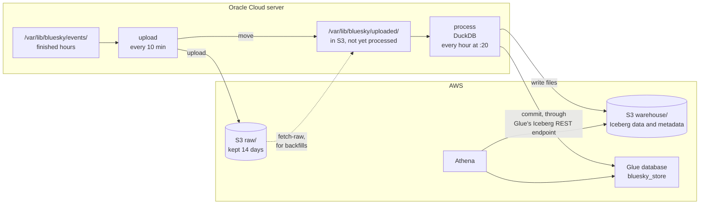

# Event store

## Purpose

The raw files keep every event exactly as Jetstream sent it, duplicates included, as JSON that has to be parsed on every query. The event store is the same log made usable: an Iceberg table in S3 with one row per distinct event and typed columns. It's append-only. A row is never removed, because an event that happened stays something that happened. The one exception to never changing a row is privacy: once a record is deleted, nightly [compaction](compaction.md) blanks what it pointed at in the events that created it ([D-034](../decisions/engineering-decisions.md#d-034-deleted-records-are-redacted-in-the-event-store)).

Everything downstream reads the event store, not the raw files. The [projections](projections.md) (current posts, likes, follows, accounts) are built by replaying it, and so will the marts be, as described in the [end-to-end pipeline](end-to-end-pipeline.md#architecture).

## Goals and non-goals

Goals:

- Every distinct event exactly once, however many times it was delivered or replayed.
- Safe to run again: loading the same files twice adds nothing.
- Each run only touches the hours its events fall in, so the work per run stays the same as the table grows.
- No post text or other record content, so a deleted post doesn't live on in the log.

Non-goals:

- Applying deletes. A delete is an event like any other and is appended. Removing the record it deletes is the job of the projections.
- Near-real-time. Data lands within about 1.5 hours of happening.

## Design

1. **Hand-off.** Once S3 has a file, the uploader moves it from `events/` to `uploaded/` under the same path, instead of deleting it. Anything in `uploaded/` is already safe in S3.
2. **Read.** `process` reads everything in `uploaded/`, up to 3 files per commit. Each file is about an hour. DuckDB reads the zstd JSON lines directly, held to 2 threads and 3 GB of memory so the collector keeps its share of the server.
3. **Parse.** Each line is parsed against a schema that names only the fields the table keeps. A line that isn't a valid event (no account, time or kind) is counted and dropped.
4. **De-duplicate within the batch.** One row per event key: account, kind, record type, record key, revision and operation for commits, plus the sequence number for identity and account events. The same key the [duplicates check](query-layer.md#saved-queries) uses.
5. **Append what's new.** Rows whose key the table already has are dropped with an anti-join, and the rest are appended in one commit. The anti-join only looks at table rows inside the batch's own time range, so on Iceberg it only needs the files whose `event_time` range overlaps it. Normally that's the hour being loaded, which is still empty. After a restart near the top of the hour, it's also the previous hour.
6. **Clean up.** After the commit, the processed files are deleted and empty folders removed. If the job dies before that, the next run loads the same files again and adds nothing.

DuckDB reaches the table through Glue's Iceberg REST endpoint: Glue keeps the table's metadata pointer, and DuckDB writes the data files to S3 itself. Athena reads the same table.

If the job stops running, files wait in `uploaded/`, at about 5 GB a day, until it's fixed. Nothing is lost.

## The events table

`bluesky_store.events`, Iceberg format v2, partitioned by the hour of `event_time`. Rows are written sorted by record type, account and time, which compresses much better than arrival order.

| Column | What it holds |
|---|---|
| `did` | The account the event belongs to |
| `event_time` | Jetstream's timestamp, in UTC, to the microsecond. It's when Jetstream processed the event, which is almost always within a second of when it happened, but can be minutes later while Jetstream catches up after a stall ([incident](../validation/incidents.md#jetstream-went-quiet-for-15-minutes-27-october)) |
| `kind` | `commit`, `identity` or `account` |
| `collection`, `operation`, `rkey`, `rev` | For commits: record type, create/update/delete, record key, repo revision |
| `seq` | For identity and account events: their sequence number |
| `subject_did` | Who the action is aimed at: the followed or blocked account, or the author of the liked or reposted record |
| `subject_collection`, `subject_rkey` | For likes and reposts: the record they point at |
| `reply_parent_uri`, `reply_root_uri` | For replies: the post replied to, and the thread's first post |
| `langs` | For posts: the languages the author tagged |
| `handle` | For identity events: the account's handle |
| `account_active`, `account_status` | For account events: whether it's active, and why not |
| `source_file` | The raw file the row came from, the same as its S3 key without `raw/` |

A like or a repost points at a record through an `at://<account>/<collection>/<key>` URI. The three parts are stored as separate columns, so the URI can be rebuilt exactly (`'at://' || subject_did || '/' || subject_collection || '/' || subject_rkey`) without storing the account twice. Jetstream's `time_us` is the same value as `event_time`, so it isn't stored twice, and the record's content hash (`cid`) isn't kept, for the reasons in [D-026](../decisions/engineering-decisions.md#d-026-a-leaner-event-store).

## Backfills

S3 keeps raw files for 14 days. `fetch-raw --date <day>` downloads a day (or one hour) into `uploaded/`, and the next run of `process` loads it. Events already in the store are skipped, so this is also how to rebuild after a bug fix, and how the hours collected before the store existed get loaded.

## Why DuckDB and Iceberg

At about 1.7 million events (about 1 GB of JSON) an hour, one machine is plenty. The job first ran on Spark; measured side by side on a real hour, DuckDB did the same work about 7 times faster with less memory and identical output, so the job moved to DuckDB ([D-025](../decisions/engineering-decisions.md#d-025-duckdb-for-the-hourly-job)). Iceberg is needed for the projections' row-level changes on files in S3 ([D-020](../decisions/engineering-decisions.md#d-020-iceberg-tables-in-the-glue-catalog)).

## Cost

- DuckDB runs on the free server.
- Reading the input costs nothing, because it reads the local copy rather than downloading from S3.
- Writing to S3 is free.
- The comparison with existing rows reads at most the hours a batch touches.
- Storage is the only real cost.

The first version of the table, measured on its first 26.3 million events, was 2.03 GB: about 77 bytes an event, or roughly 2.8 GB a day, and 55% of the compressed raw files for the same hours. Iceberg records every column's size per file, so the breakdown came straight from its metadata:

| Column | Share of the table |
|---|---|
| `cid` | 42% |
| `subject_uri` | 16% |
| `subject_did` | 9% |
| `rkey` | 8% |
| `rev` | 7% |
| `event_time` and `time_us` | 6% each |
| Everything else | 6% |

Random-looking identifiers barely compress, and `cid`, a 59-character content hash that no metric uses, was the biggest by far. The current table drops `cid` and `time_us` and splits `subject_uri` into its parts ([D-026](../decisions/engineering-decisions.md#d-026-a-leaner-event-store)). Rebuilt that way, it's **31.3 bytes an event**, about 1.2 GB a day:

| Column | Bytes per event |
|---|---|
| `subject_did` | 6.1 |
| `rkey` | 5.9 |
| `rev` | 5.8 |
| `event_time` | 4.4 |
| `subject_rkey` | 3.9 |
| `did` | 3.3 |
| Everything else | under 2 together |
