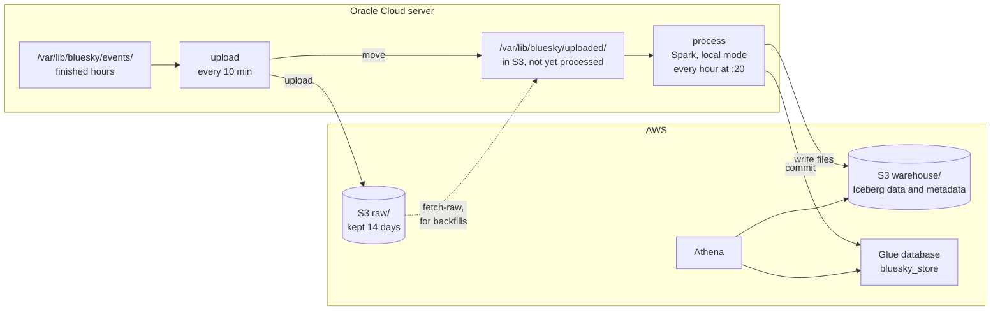

# Event store

## Purpose

The raw files keep every event exactly as Jetstream sent it, duplicates included, as JSON that has to be parsed on every query. The event store is the same log made usable: an Iceberg table in S3 with one row per distinct event and typed columns. It's append-only. A row is never updated or removed by normal processing, because an event that happened stays something that happened.

Everything downstream reads the event store, not the raw files. Projections (current posts, likes, follows, accounts) are built by replaying it, and so are the marts, as described in the [end-to-end pipeline](end-to-end-pipeline.md#architecture).

## Goals and non-goals

Goals:

- Every distinct event exactly once, however many times it was delivered or replayed.
- Safe to run again: loading the same files twice adds nothing.
- Each run only touches the hours its events fall in, so the work per run stays the same as the table grows.
- No post text or other record content, so a deleted post doesn't live on in the log.

Non-goals:

- Applying deletes. A delete is an event like any other and is appended. Removing the record it deletes is the job of the projections.
- Near-real-time. Data lands within about 1.5 hours of happening.

## Design

1. **Hand-off.** Once S3 has a file, the uploader moves it from `events/` to `uploaded/` under the same path, instead of deleting it. Anything in `uploaded/` is already safe in S3.
2. **Read.** `process` reads everything in `uploaded/`, up to 3 files per commit. Each file is about an hour. Spark reads zstd directly. A `.zst` file can't be split, so the lines are spread across all cores before parsing.
3. **Parse.** Each line is parsed against a schema that names only the fields the table keeps. A line that isn't a valid event (no account, time or kind) is counted and dropped.
4. **De-duplicate within the batch.** One row per event key: account, kind, record type, record key, revision and operation for commits, plus the sequence number for identity and account events. The same key the [duplicates check](query-layer.md#saved-queries) uses.
5. **Insert what's new.** A `MERGE` with only a "when not matched, insert" clause adds the rows the table doesn't have yet. Its join is limited to the batch's own time range, so Iceberg reads only the table files whose `event_time` range overlaps it. Normally that's the hour being loaded, which is still empty. After a restart near the top of the hour, it's also the previous hour.
6. **Clean up.** After the commit, the processed files are deleted and empty folders removed. If the job dies before that, the next run loads the same files again and the merge adds nothing.

If the job stops running, files wait in `uploaded/`, at about 5 GB a day, until it's fixed. Nothing is lost.

## The events table

`bluesky_store.events`, Iceberg format v2, Parquet with zstd, partitioned by the hour of `event_time`. Rows inside each file are sorted by record type, account and time, which compresses much better than arrival order.

| Column | What it holds |
|---|---|
| `did` | The account the event belongs to |
| `time_us`, `event_time` | Jetstream's timestamp, in microseconds and as a UTC timestamp |
| `kind` | `commit`, `identity` or `account` |
| `collection`, `operation`, `rkey`, `rev`, `cid` | For commits: record type, create/update/delete, record key, repo revision, record content hash |
| `seq` | For identity and account events: their sequence number |
| `subject_did` | Who the action is aimed at: the followed or blocked account, or the author of the liked or reposted post |
| `subject_uri` | The liked or reposted post |
| `reply_parent_uri`, `reply_root_uri` | For replies: the post replied to, and the thread's first post |
| `langs` | For posts: the languages the author tagged |
| `handle` | For identity events: the account's handle |
| `account_active`, `account_status` | For account events: whether it's active, and why not |
| `source_file` | The raw file the row came from, the same as its S3 key without `raw/` |

A like and a repost both point at a post through an `at://` URI that starts with the author's account, so `subject_did` comes from the URI with no lookup.

## Backfills

S3 keeps raw files for 14 days. `fetch-raw --date <day>` downloads a day (or one hour) into `uploaded/`, and the next run of `process` loads it. Events already in the store are skipped, so this is also how to rebuild after a bug fix, and how the hours collected before the store existed get loaded.

## Why Spark and Iceberg

At about 1.5 million events (about 1 GB of JSON) an hour, one machine is plenty, and Spark isn't needed for scale. Iceberg is needed for the projections' row-level changes on files in S3. The reasoning and trade-offs are in [D-019](../decisions/engineering-decisions.md#d-019-spark-in-local-mode-on-the-server) and [D-020](../decisions/engineering-decisions.md#d-020-iceberg-tables-in-the-glue-catalog).

## Cost

- Spark runs on the free server.
- Reading the input costs nothing, because it reads the local copy rather than downloading from S3.
- Writing to S3 is free.
- The merge reads at most the hours a batch touches.
- Storage is the only real cost.

Measured on the first 26.3 million events, the table is 2.03 GB, about 77 bytes an event, or roughly 2.8 GB a day. That's 55% of the compressed raw files for the same hours. Iceberg records every column's size per file, so the breakdown comes straight from its metadata:

| Column | Share of the table |
|---|---|
| `cid` | 42% |
| `subject_uri` | 16% |
| `subject_did` | 9% |
| `rkey` | 8% |
| `rev` | 7% |
| `event_time` and `time_us` | 6% each |
| Everything else | 6% |

Random-looking identifiers barely compress, and `cid`, a 59-character content hash that no metric uses, is the biggest by far.
