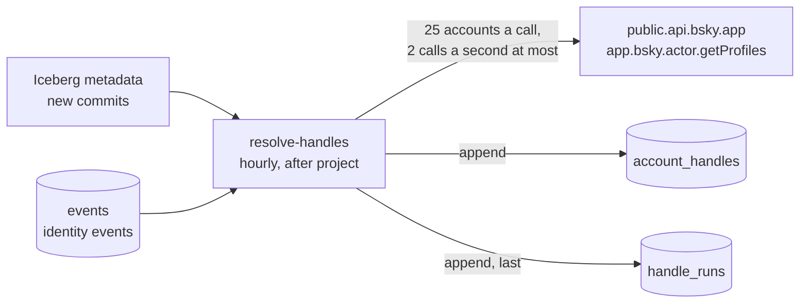

# Handle lookups

## Purpose

Account history in the [marts](marts.md) follows handles: `alice.bsky.social` becoming `alice.com` starts a new version of the account. Jetstream's identity events are supposed to be where handle changes show up, but they almost never carry the handle. Of the first 74,610 identity events, 28 had one. In the protocol the field is optional: an identity event is a signal that an account's identity changed, and anyone who needs the new handle is expected to look it up.

`resolve-handles` does that lookup, and keeps the answers in the event store's database for the marts to use.

## Goals and non-goals

Goals:

- A handle for every account whose identity changes, from the moment collection started.
- Polite to the API: well under its limits, backing off when asked to.
- Safe to rerun: a crash means the same commit is looked up again, nothing lost.

Non-goals:

- Handles for accounts whose identity never changes while we watch. Most accounts never change, and the marts don't need their handles; only changes make history.
- Display names, bios or other profile content. The API returns them; they're deliberately not stored.

## Design

1. **Find what's new.** Like the projections, it reads the store's Iceberg metadata, skips commits that only rewrote rows, and takes the commits added since its last run, oldest first ([D-030](../decisions/engineering-decisions.md#d-030-new-store-commits-are-found-by-their-iceberg-sequence-number)).
2. **Read the identity events** in each commit's files, and keep the newest per account.
3. **Look them up** through `app.bsky.actor.getProfiles` on Bluesky's public API, 25 accounts per call, at most two calls a second. A 429 or a server error waits as long as the API asks, or doubles, up to 5 tries. A 400 for a batch is retried one account at a time, so one bad ID doesn't lose the other 24.
4. **Append** one row per account to `account_handles`, then log the commit in `handle_runs`.

An account the API doesn't return, because it's deleted, deactivated or suspended, gets a row with `found = false` and no handle. The marts skip those rows, and take the account's status from account events instead.

## The tables

**`account_handles`**, partitioned by the month of the identity event:

| Column | What it holds |
|---|---|
| `did` | The account |
| `identity_time`, `identity_seq` | The identity event the lookup answers: its time and relay sequence number |
| `looked_up_at` | When the API was asked |
| `handle` | The handle the API returned. `handle.invalid` if the account's handle doesn't verify |
| `found` | Whether the API returned the account at all |

The handle is the one current at lookup time, usually within the hour of the identity event. If an account changes handle twice within the same hour, the first one is missed.

**`handle_runs`**: one row per store commit: the sequence numbers, identity events read, accounts looked up, how many were found, and API calls made.

## Deletes

Handles are public on Bluesky, but a deleted account's handle shouldn't outlive it here. Nightly [compaction](compaction.md) removes every row of `account_handles` for accounts that were deleted, on the same tiers as everything else, and the next marts build drops them from account history.

## Failure handling

| What happens | Result |
|---|---|
| The API is down or keeps refusing | The run stops after 5 tries for a batch, before logging that commit. The next hourly run looks it up again |
| The job dies between appending and logging | That commit is looked up again, and its rows appended twice. The marts take the latest per account and time, so it changes nothing |
| An identity event arrives late, in an old hour | It's in a new commit, so it's looked up like any other |

## In production

The first run looked up every identity change since collection began, in 23 runs: one per commit that still has live files. Most of the store's files had been rewritten by compaction, and its commits were already expired by the vacuum, so the job couldn't tell them apart from appends and read them as new. For a first run that's exactly right, since every identity event in them still needed looking up.

| | |
|---|---|
| Identity events | 88,247 |
| Accounts looked up | 83,466 |
| Found, with a handle | 72,319 (86.6%) |
| Not returned: deleted, deactivated or suspended | 11,147 (13.4%) |
| API calls | 3,347, no retries |
| Time per hourly run since | 20 to 40 seconds |

About one identity change in seven belongs to an account that's going away rather than changing its handle.

After the next marts build, `dim_account` had handles for 71,673 of its 2,080,725 accounts, across 126,693 versions; 602 of them `handle.invalid`. The rest have never changed identity since collection began, so they have status history only.

## Cost

About 25,000 identity events a day, about 1,000 API calls. The public API is free. Reading identity events reads only four columns of each new store file.
