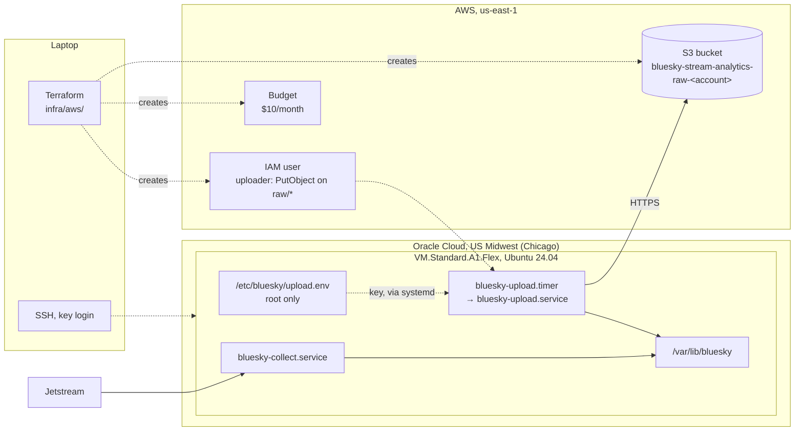

# Infrastructure

## Purpose

Two clouds, each for what it does best within the budget: an always-free Oracle Cloud server runs the collector and uploader, and AWS stores and later queries the data. The AWS side is Terraform in `infra/aws/`; the server's services are unit files in `deploy/systemd/`. The reasons for the split are in [D-008](../decisions/engineering-decisions.md#d-008-collector-server-on-oracle-cloud-data-on-aws).

## Design

## The server

| | |
|---|---|
| Provider | Oracle Cloud Always Free, home region US Midwest (Chicago) |
| Shape | `VM.Standard.A1.Flex` (ARM), 2 OCPU, 12 GB memory, 100 GB boot volume |
| OS | Ubuntu 24.04 (aarch64) |
| Account | Pay As You Go, so the server isn't reclaimed as idle. Free within the Always Free limits |
| Network | Only SSH (22) open inbound, key login only. The programs only connect outbound |

| Path | What |
|---|---|
| `/opt/bluesky-stream-analytics` | Git checkout of this repo, with its virtual environment |
| `/var/lib/bluesky` | Collector data (`events/`, `state/cursor.json`) |
| `/etc/bluesky/upload.env` | Bucket name and the uploader's AWS key, `root:root`, mode `600` |
| `/etc/systemd/system/bluesky-*` | Copies of `deploy/systemd/` |

| Unit | What it does |
|---|---|
| `bluesky-collect.service` | Runs `collect`. Starts on boot, restarts 5 seconds after a crash, stopped with `SIGTERM` so the current file is finished |
| `bluesky-upload.timer` | Starts `bluesky-upload.service` at :00, :10, :20 … every hour |
| `bluesky-upload.service` | Runs `upload` once. systemd reads the key file as root and passes the values in as environment variables |

Both programs run as an unprivileged `bluesky` user. systemd keeps the rest of the filesystem read-only to them, so the only place they can write is `/var/lib/bluesky`. Logs go to the systemd journal.

A1 capacity is only needed to start an instance, so the server is rebooted, never stopped. A stopped instance can only start again if the region has free capacity.

## AWS

| Resource | Setup |
|---|---|
| S3 bucket `bluesky-stream-analytics-raw-<account id>` | `us-east-1`, private, public access blocked, encrypted, HTTPS only, incomplete uploads cleaned up after 1 day |
| IAM user `bluesky-stream-analytics-uploader` | Only `s3:PutObject` under `raw/`. Its access key is created outside Terraform, so the secret never lands in the state file |
| Budget `bluesky-stream-analytics-monthly` | $10 a month, measured before credits. Emails at 80% of actual spend and when the month is forecast to go over |

Terraform state is kept locally and ignored by git.
