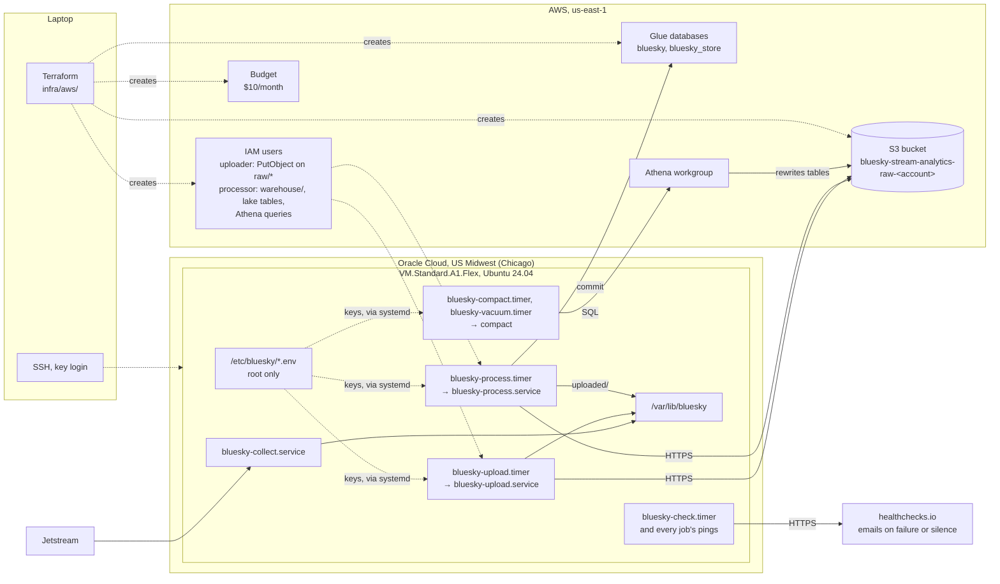

# Infrastructure

## Purpose

An always-free Oracle Cloud server runs the collector, the uploader and the event store job, and AWS stores and queries the data. The AWS side is Terraform in `infra/aws/`, the server's services are unit files in `deploy/systemd/`. The reasons for the split are in [D-008](../decisions/engineering-decisions.md#d-008-collector-server-on-oracle-cloud-data-on-aws).

## Design

## The server

| | |
|---|---|
| Provider | Oracle Cloud Always Free, home region US Midwest (Chicago) |
| Shape | `VM.Standard.A1.Flex` (ARM), 2 OCPU, 12 GB memory, 100 GB boot volume |
| OS | Ubuntu 24.04 (aarch64), with `build-essential`: one of dbt's dependencies (`mmh3` 4.1) has no prebuilt package for Python 3.14 on ARM and is compiled when installed |
| Account | Pay As You Go, so the server isn't reclaimed as idle. Free within the Always Free limits |
| Network | VCN `bluesky-vcn` (`10.0.0.0/16`) with an internet gateway, a default route `0.0.0.0/0` to it, and a public subnet `10.0.0.0/24`. Only SSH (22) open inbound, key login only. The programs only connect outbound: to Jetstream, to AWS, and to Bluesky's public API for handle lookups |

| Path | What |
|---|---|
| `/opt/bluesky-stream-analytics` | Git checkout of this repo, with its virtual environment |
| `/var/lib/bluesky` | Collector data (`events/`, `state/cursor.json`), files waiting for the event store job (`uploaded/`), and DuckDB's extensions (`duckdb-extensions/`) |
| `/etc/bluesky/upload.env` | Bucket name and the uploader's AWS key, `root:root`, mode `600` |
| `/etc/bluesky/process.env` | Bucket name and the processor's AWS key, `root:root`, mode `600` |
| `/etc/bluesky/monitor.env` | The healthchecks.io ping key, `root:root`, mode `600` |
| `/etc/systemd/system/bluesky-*` | Copies of `deploy/systemd/` |

| Unit | What it does |
|---|---|
| `bluesky-collect.service` | Runs `collect`. Starts on boot, restarts 5 seconds after a crash, stopped with `SIGTERM` so the current file is finished |
| `bluesky-upload.timer` | Starts `bluesky-upload.service` at :00, :10, :20 … every hour |
| `bluesky-upload.service` | Runs `upload` once. systemd reads the key file as root and passes the values in as environment variables |
| `bluesky-process.timer` | Starts `bluesky-process.service` at 20 past every hour |
| `bluesky-compact.timer` | Starts `bluesky-compact.service` at 03:45 UTC every night |
| `bluesky-compact.service` | Runs `compact`, which sends the night's compaction to Athena and waits for it |
| `bluesky-vacuum.timer` | Starts `bluesky-vacuum.service` at 05:45 UTC every night |
| `bluesky-vacuum.service` | Runs `compact --vacuum`, which expires old snapshots and deletes unused files |
| `bluesky-marts.timer` | Starts `bluesky-marts.service` at 04:30 UTC every night |
| `bluesky-marts.service` | Runs `dbt build`, which builds and tests the marts in Athena |
| `bluesky-check.timer` | Starts `bluesky-check.service` at :05, :15, :25 … every hour |
| `bluesky-check.service` | Runs `check-health`, which checks the newest event, the file backlogs and the disk, and pings healthchecks.io ([monitoring](monitoring.md)) |
| `bluesky-alert@.service` | Started by systemd when a scheduled job fails; sends the end of its log to healthchecks.io |
| `bluesky-process.service` | Runs the event store job once, then the projections job, then the handle lookups. DuckDB is held to 2 threads and 3 GB, the service runs at a lower CPU priority than the collector, and systemd caps it at 4 GB of memory |

All of them run as an unprivileged `bluesky` user, and the jobs that write to the lake tables take the same lock first (`flock /var/lib/bluesky/lake.lock`), so only one commits at a time ([D-035](../decisions/engineering-decisions.md#d-035-one-writer-at-a-time)). systemd keeps the rest of the filesystem read-only to them, so the only place they can write is `/var/lib/bluesky`. Logs go to the systemd journal.

A1 capacity is only needed to start an instance, so the server is rebooted, never stopped. A stopped instance can only start again if the region has free capacity.

## AWS

| Resource | Setup |
|---|---|
| S3 bucket `bluesky-stream-analytics-raw-<account id>` | `us-east-1`, private, public access blocked, encrypted, HTTPS only, incomplete uploads cleaned up after 1 day. Raw files under `raw/` expire after 14 days; Iceberg tables live under `warehouse/` |
| IAM user `bluesky-stream-analytics-uploader` | Only `s3:PutObject` under `raw/`. Its access key is created outside Terraform, so the secret never lands in the state file |
| IAM user `bluesky-stream-analytics-processor` | Reads, writes and deletes under `warehouse/`, reads (never changes) `raw/`, and creates and updates tables in `bluesky_store` only. It can also read the Glue catalog and list database names, which Glue's Iceberg REST endpoint needs. For compaction and the marts, it can run queries in the project's Athena workgroup and write their results under `athena-results/`, and manage tables in `bluesky_marts`. That last part is a managed policy attached to the user, because IAM caps a user's inline policies at 2,048 characters in total. Key created outside Terraform too |
| Glue database `bluesky_store` | The event store's Iceberg table, located at `warehouse/bluesky_store/` |
| Glue database `bluesky_marts` | The marts, created and replaced by dbt, located at `warehouse/bluesky_marts/` |
| Glue database `bluesky`, table `raw_events` | External table over `raw/events/`, partitions projected from the path. See [query layer](query-layer.md) |
| Athena workgroup `bluesky-stream-analytics` | 10 GB scan limit per query, results in `athena-results/` (expire after 7 days), settings enforced |
| Budget `bluesky-stream-analytics-monthly` | $10 a month, measured before credits. Emails at 80% of actual spend and when the month is forecast to go over |

Terraform state is kept locally and ignored by git.
