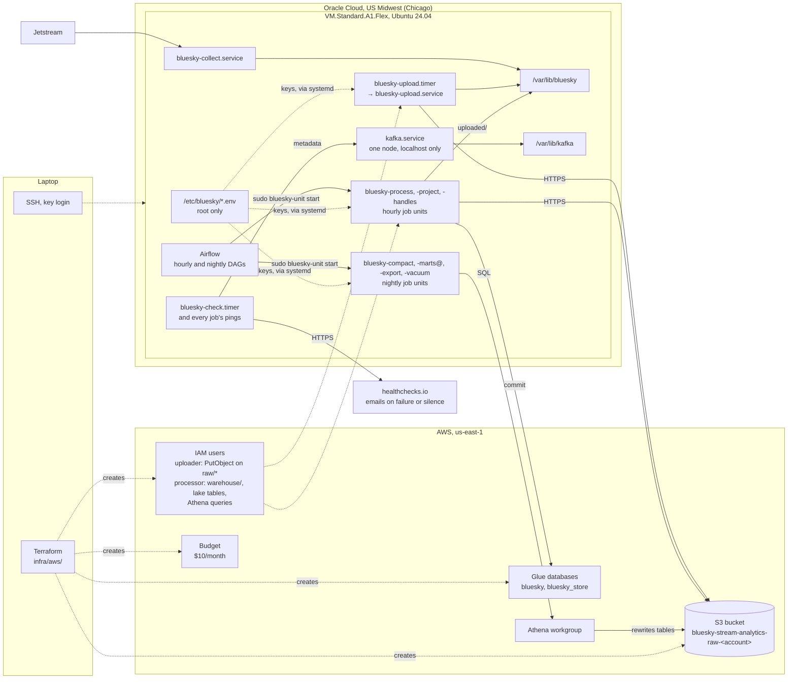

# Infrastructure

## Purpose

An always-free Oracle Cloud server runs the collector and every scheduled job, AWS stores and queries the data, and GitHub hosts the public report. The AWS side is Terraform in `infra/aws/`, the server's services are unit files in `deploy/systemd/`. The reasons for the split are in [D-008](../decisions/engineering-decisions.md#d-008-collector-server-on-oracle-cloud-data-on-aws).

## Design



## The server

| | |
|---|---|
| Provider | Oracle Cloud Always Free, home region US Midwest (Chicago) |
| Shape | `VM.Standard.A1.Flex` (ARM), 2 OCPU, 12 GB memory, 100 GB boot volume |
| OS | Ubuntu 24.04 (aarch64), with `build-essential`: one of dbt's dependencies (`mmh3` 4.1) has no prebuilt package for Python 3.14 on ARM and is compiled when installed |
| Account | Pay As You Go, so the server isn't reclaimed as idle. Free within the Always Free limits |
| Network | VCN `bluesky-vcn` (`10.0.0.0/16`) with an internet gateway, a default route `0.0.0.0/0` to it, and a public subnet `10.0.0.0/24`. Only SSH (22) open inbound, key login only; Airflow's UI and Kafka listen on localhost, and the UI is reached through an SSH tunnel. The programs only connect outbound: to Jetstream, to AWS, and to Bluesky's public API for handle lookups |

| Path | What |
|---|---|
| `/opt/bluesky-stream-analytics` | Git checkout of this repo, with its virtual environment |
| `/var/lib/bluesky` | Collector data (`events/`, `state/cursor.json`), files waiting for the event store job (`uploaded/`), and DuckDB's extensions (`duckdb-extensions/`) |
| `/etc/bluesky/upload.env` | Bucket name and the uploader's AWS key, `root:root`, mode `600` |
| `/etc/bluesky/process.env` | Bucket name and the processor's AWS key, `root:root`, mode `600` |
| `/etc/bluesky/monitor.env` | The healthchecks.io ping key, `root:root`, mode `600` |
| `/etc/bluesky/airflow-secrets.env` | The keys Airflow's components sign their requests to each other with, `root:root`, mode `600` |
| `/etc/systemd/system/bluesky-*`, `airflow-*` | Copies of `deploy/systemd/` and of the units in `deploy/airflow/` |
| `/opt/airflow/venv` | Airflow 3.3.2, in its own virtual environment |
| `/opt/airflow/python` | The Python 3.14 Airflow's environment runs on, outside any user's home so the `airflow` user can read it |
| `/var/lib/airflow` | Airflow's home: logs, and the generated UI password |
| `/opt/kafka` | Apache Kafka 4.3.2, unpacked from the release tarball, owned by root |
| `/etc/kafka/server.properties` | Copy of `deploy/kafka/server.properties` |
| `/var/lib/kafka/data` | Kafka's log segments and cluster metadata, owned by the `kafka` user |
| `/var/log/kafka` | Kafka's own logs, kept as well as the journal |
| `/var/lib/bluesky/shadow` | The Kafka path's output while it runs beside the file collector: the second collector's cursor (`collector/`) and the archiver's hourly files (`archive/events/`). Nothing uploads or processes these |
| `/usr/local/sbin/bluesky-unit` | The script Airflow starts job units through, `root:root`, mode `755` |
| `/etc/sudoers.d/bluesky-airflow` | Lets the `airflow` user run `bluesky-unit` as root, and nothing else |

| Unit | What it does |
|---|---|
| `bluesky-collect.service` | Runs `collect`. Starts on boot, restarts 5 seconds after a crash, stopped with `SIGTERM` so the current file is finished |
| `bluesky-upload.timer` | Starts `bluesky-upload.service` at :00, :10, :20 … every hour |
| `bluesky-upload.service` | Runs `upload` once. systemd reads the key file as root and passes the values in as environment variables |
| `bluesky-check.timer` | Starts `bluesky-check.service` at :05, :15, :25 … every hour |
| `bluesky-check.service` | Runs `check-health`, which checks the newest event, the file backlogs, the disk and Kafka, and pings healthchecks.io ([monitoring](monitoring.md)) |
| `bluesky-process.service` | Runs `process`, which loads the uploaded files into the event store. DuckDB is held to 2 threads and 3 GB, the service runs at a lower CPU priority than the collector, and systemd caps it at 4 GB of memory, as for the next two |
| `bluesky-project.service` | Runs `project`, which folds new store commits into the projections |
| `bluesky-handles.service` | Runs `resolve-handles`, which looks up the handles of accounts whose identity changed |
| `bluesky-compact.service` | Runs `compact`, which sends the night's compaction to Athena and waits for it |
| `bluesky-marts@.service` | Runs `dbt build` for the two days before the date in its name, building and testing the marts in Athena |
| `bluesky-export.service` | Runs `export-dashboard`, which writes the report's numbers to S3 |
| `bluesky-vacuum.service` | Runs `compact --vacuum`, which expires old snapshots and deletes unused files |
| `bluesky-alert@.service` | Started by systemd when a job fails; sends the end of its log to healthchecks.io |
| `airflow-api-server.service` | Airflow's API and web UI, on `127.0.0.1:8080` only, reached through an SSH tunnel |
| `airflow-scheduler.service` | Runs the DAGs, and their tasks with the LocalExecutor |
| `airflow-dag-processor.service` | Reads the DAG files from the checkout |
| `postgresql.service` | Airflow's database, reached over the local socket with no password |
| `bluesky-shadow-collect.service` | Runs `collect --kafka`, a second collector that sends every event to the `jetstream.events` topic instead of writing files. It saves its cursor only once Kafka has acknowledged everything sent |
| `bluesky-shadow-archive.service` | Runs `archive`, which reads the topic and writes the same hourly files as the collector, under `/var/lib/bluesky/shadow/archive`. It commits its Kafka offsets only once the files are synced to disk |
| `kafka.service` | Apache Kafka as a single node, broker and KRaft controller in one process, on `127.0.0.1` only, as the unprivileged `kafka` user. Java 21, a 1 GB heap, and systemd caps it at 2 GB of memory. Topics are only created by `ensure-topic`, which creates `jetstream.events` or brings its settings in line with `topic.py`. The topic keeps events for up to 72 hours, capped at 4 GiB per partition, so Kafka never holds more than 12 GiB of the disk |

The job units have no timers: the [Airflow DAGs](orchestration.md) start them, each after the one it depends on. The collector, the uploader and the health check keep their own systemd timers, so that collecting data and alerting don't depend on Airflow.

The `bluesky-*` units run as an unprivileged `bluesky` user, and the jobs that write to the lake tables take the same lock first (`flock /var/lib/bluesky/lake.lock`), so only one commits at a time ([D-035](../decisions/engineering-decisions.md#d-035-one-writer-at-a-time)). systemd keeps the rest of the filesystem read-only to them, so the only place they can write is `/var/lib/bluesky`. Logs go to the systemd journal.

A1 capacity is only needed to start an instance, so the server is rebooted, never stopped. A stopped instance can only start again if the region has free capacity.

### Setting up Kafka

`kafka.service` expects four things to exist before it starts: the `kafka` user, the config in `/etc/kafka`, data and log directories that user owns, and storage formatted for KRaft. Kafka refuses to start on unformatted storage, and formatting is done once, as the step that gives the node its cluster ID. The health check comes last, because once its unit passes `--kafka` it fails whenever the broker or the topic is missing.

1. Java and Kafka. The release is checked against its published SHA-512 before unpacking:

   ```
   sudo apt-get install -y openjdk-21-jre-headless
   curl -fLO https://dlcdn.apache.org/kafka/4.3.2/kafka_2.13-4.3.2.tgz
   curl -fLO https://downloads.apache.org/kafka/4.3.2/kafka_2.13-4.3.2.tgz.sha512
   sha512sum kafka_2.13-4.3.2.tgz; cat kafka_2.13-4.3.2.tgz.sha512
   sudo tar -xzf kafka_2.13-4.3.2.tgz -C /opt && sudo ln -sfn /opt/kafka_2.13-4.3.2 /opt/kafka
   ```

2. The user, the config and the directories:

   ```
   sudo useradd --system --no-create-home --shell /usr/sbin/nologin kafka
   sudo install -d /etc/kafka
   sudo install -m 644 /opt/bluesky-stream-analytics/deploy/kafka/server.properties /etc/kafka/
   sudo install -d -o kafka -g kafka /var/lib/kafka /var/log/kafka
   ```

3. Format the storage, as the `kafka` user so it owns what's written:

   ```
   CLUSTER_ID=$(LOG_DIR=/tmp /opt/kafka/bin/kafka-storage.sh random-uuid)
   sudo -u kafka env LOG_DIR=/var/log/kafka /opt/kafka/bin/kafka-storage.sh format \
     --standalone -t "$CLUSTER_ID" -c /etc/kafka/server.properties
   ```

4. Start it, and check the journal shows the server started:

   ```
   sudo install -m 644 /opt/bluesky-stream-analytics/deploy/kafka/kafka.service /etc/systemd/system/
   sudo systemctl daemon-reload && sudo systemctl enable --now kafka
   journalctl -u kafka -n 20 --no-pager
   ```

5. Create the topic, as the `bluesky` user, since the virtual environment's Python lives in its home. A second run should report that it already matches:

   ```
   sudo -u bluesky /opt/bluesky-stream-analytics/.venv/bin/ensure-topic
   ```

6. Only then install the health check unit that checks Kafka:

   ```
   sudo install -m 644 /opt/bluesky-stream-analytics/deploy/systemd/bluesky-check.service /etc/systemd/system/
   sudo systemctl daemon-reload && sudo systemctl start bluesky-check.service
   ```

   Its summary should end with "kafka up, 3 partitions".

A topic's settings change by editing `topic.py` and running `ensure-topic` again. Its partition count never changes that way.

## AWS

| Resource | Setup |
|---|---|
| S3 bucket `bluesky-stream-analytics-raw-<account id>` | `us-east-1`, private, public access blocked, encrypted, HTTPS only, incomplete uploads cleaned up after 1 day. Raw files under `raw/` expire after 14 days; Iceberg tables live under `warehouse/`, and the dashboard's export under `dashboard/` |
| IAM user `bluesky-stream-analytics-uploader` | Only `s3:PutObject` under `raw/`. Its access key is created outside Terraform, so the secret never lands in the state file |
| IAM user `bluesky-stream-analytics-processor` | Reads, writes and deletes under `warehouse/`, reads (never changes) `raw/`, and creates and updates tables in `bluesky_store` only. It can also read the Glue catalog and list database names, which Glue's Iceberg REST endpoint needs. For compaction and the marts, it can run queries in the project's Athena workgroup and write their results under `athena-results/`, and manage tables in `bluesky_marts`. That last part is a managed policy attached to the user, because IAM caps a user's inline policies at 2,048 characters in total. Key created outside Terraform too |
| Glue database `bluesky_store` | The event store's Iceberg table, located at `warehouse/bluesky_store/` |
| Glue database `bluesky_marts` | The marts, created and replaced by dbt, located at `warehouse/bluesky_marts/` |
| Glue database `bluesky`, table `raw_events` | External table over `raw/events/`, partitions projected from the path. See [query layer](query-layer.md) |
| Athena workgroup `bluesky-stream-analytics` | 10 GB scan limit per query, results in `athena-results/` (expire after 7 days), settings enforced |
| IAM role `bluesky-stream-analytics-dashboard` | Assumed by the dashboard's GitHub Actions workflow through GitHub's OIDC provider, only for this repository's Pages deployments. It can read `dashboard/dashboard.json` and nothing else. The processor can write that file ([dashboard](dashboard.md)) |
| Budget `bluesky-stream-analytics-monthly` | $10 a month, measured before credits. Emails at 80% of actual spend and when the month is forecast to go over |

Terraform state is kept locally and ignored by git.
