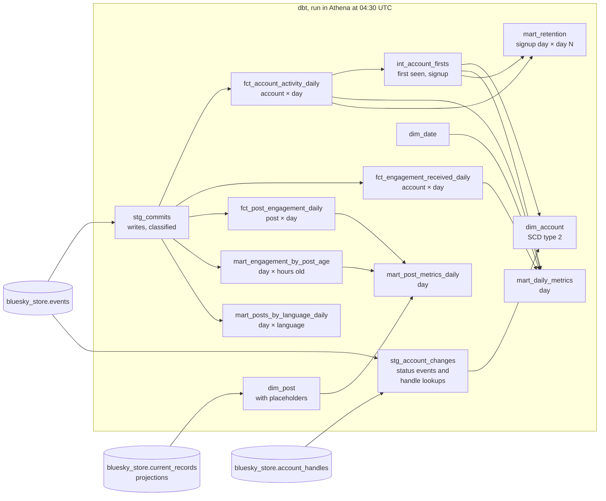

# Marts

## Purpose

The marts are where the product metrics come from: how many accounts are active, how many are new and whether they stay, what people do, and how concentrated attention is. They're a Kimball star schema built with dbt from the [event store](event-store.md), so each metric is defined once, in SQL, with tests.

They come in two parts: accounts (activity, engagement received, history, retention) and posts (engagement per post, how fast it arrives, languages, and replies to posts we never saw).

## Goals and non-goals

Goals:

- Every metric defined once, in one place, with its caveats written next to it.
- Rebuilt daily for the day before, at the cost of a cent or so.
- Tested twice: on the real data in Athena, and on a hand-made sample in CI with numbers worked out by hand.

Non-goals:

- Publishing anything. The marts are private; only aggregates leave, through the dashboard, with small groups suppressed.
- Real time. Daily is enough for these metrics, and keeps the cost flat.

## Design

| Model | Kind | One row per | Built |
|---|---|---|---|
| `dim_date` | dimension | day of collection | in full |
| `dim_account` | dimension, SCD type 2 | version of an account: a new one whenever its handle or status changes | in full |
| `fct_account_activity_daily` | fact | account and day it wrote anything: posts, replies, likes, reposts, follows, blocks, edits, deletes | the last 2 days again, each night |
| `fct_engagement_received_daily` | fact | account and day it received likes, reposts, replies or follows from another account | the last 2 days again |
| `mart_daily_metrics` | metrics | day | the last 2 days again |
| `mart_retention` | metrics | signup day and day 1, 7 or 30 | in full |
| `dim_post` | dimension | post that exists now, plus a placeholder for every post a reply points at that hasn't been seen | in full, from the projections |
| `fct_post_engagement_daily` | fact | post and day it received likes, reposts or replies from other accounts | the last 2 days again |
| `mart_engagement_by_post_age` | metrics | day and the age of the post, in hours, when the engagement came | the last 2 days again |
| `mart_post_metrics_daily` | metrics | day | the last 2 days again |
| `mart_posts_by_language_daily` | metrics | day and first tagged language | the last 2 days again |

The facts and daily metrics are incremental: each night clears and rebuilds the last 2 days, since an hour can reach the event store late. The account dimension is a few rows per account, so rebuilding it in full stays cheap.

## Posts we never saw

Most replies answer posts that were made before collection began, or whose create hasn't reached us yet: Jetstream can deliver a reply before its parent. A star schema needs every reply's parent to have a row to join to, so `dim_post` adds a placeholder for each one (what Kimball calls an inferred member). A placeholder still has the author, from the parent's URI, and the creation time, decoded from its key. Once the real post's create arrives, the next build has the real row instead, and the placeholder is gone; a test checks every reply's parent and root have a row.

`dim_post` is built in full each night from the [projections](projections.md)' `current_records`, not from the event store. That way a deleted post drops out of it at the next build, along with its reply links, with no deletion logic of its own ([D-040](../decisions/engineering-decisions.md#d-040-posts-come-from-the-projections-with-placeholders-for-unseen-parents)).

## The metrics, defined

| Metric | Definition |
|---|---|
| Daily, weekly, monthly active | Accounts that wrote anything to a Bluesky record type (post, like, follow, profile edit and so on) on that day, in the 7 days, or in the 30 days ending that day |
| New accounts | Accounts that created their profile that day with nothing seen from them more than an hour before. See below |
| Posts, replies, likes, reposts, follows, blocks, deletes | Writes of each kind that day. A reply is a post with a parent |
| Engagement received | Likes, reposts and replies from other accounts. Liking your own post doesn't count |
| Top 1% share | The share of the day's engagement received by the top 1% of the accounts that received any, rounded up to at least one account |
| Gini | How unequal engagement received was that day: 0 if every account that received any got the same, close to 1 if one got nearly all |
| Day N retention | Of the accounts that signed up on a day, the share that wrote anything exactly N days later |
| Posts engaged | Posts that received any like, repost or reply from another account that day |
| Replies to unseen posts | Replies made that day whose parent has only a placeholder in `dim_post` |
| Engagement by post age | Likes, reposts and replies received, by whole hours between the post's creation and the engagement. 48 means two days or more; -1 means the post's key doesn't give a believable creation time |
| Share to posts under a day | The share of the day's engagement that went to posts less than 24 hours old |
| Posts by language | Posts and replies made that day, by the first language the author tagged; `none` when untagged |

**Caveats that stay next to these numbers:**

- **Active means wrote something.** The firehose carries writes only, so an account that only reads is invisible. These are active writers, not users.
- **The first days undercount the windows.** Weekly figures cover a full week from 30 October and monthly ones a full month from 22 November; `weekly_complete` and `monthly_complete` say which days are which.
- **New accounts are inferred.** The feed has no "signup" event. An account's first profile record is the clearest sign; requiring that nothing was seen from the account more than an hour earlier rules out accounts that existed before collection and only now set a profile. Checked on a real day, 99.5% of profile creators also had a handle set within the hour, as new accounts do ([details](../validation/testing.md#new-accounts-checked)).
- **Engagement on deleted records stops counting** once compaction redacts them, but only for the days rebuilt after that. Counts for older days stay as they were built.
- **Follows only from 24 October on.** There's no follower count, because follows made before collection began are invisible.
- **Handles come from lookups.** Jetstream's identity events almost never carry the handle, so `resolve-handles` asks Bluesky's API for it whenever an account's identity changes ([handle lookups](handles.md)). Accounts whose identity hasn't changed since collection began have no handle in their history, only status.
- **A post's age comes from its key**, which is the creation time the author's app chose. A few apps make keys from counters or random bits; those land in the -1 bucket.
- **"Unseen" is as of the night the day was built.** A placeholder replaced later doesn't change older days.
- **Quote posts don't count as engagement.** A quote is an embed in the post's content, which the event store doesn't keep.
- **Display names aren't tracked.** The event store keeps no record content, and the handle lookups deliberately don't keep it either, so account history follows handles and status only.

## Privacy

- Accounts are keyed by a SHA-256 hash of their DID. DIDs are public, so this is pseudonymization, not anonymization: it keeps raw account IDs out of the marts, nothing more ([D-038](../decisions/engineering-decisions.md#d-038-accounts-are-hashed-and-handles-kept-in-private-marts)).
- `dim_account` keeps handles, which are public on Bluesky and are what its history tracks. The marts are never published as tables.
- The facts are counts. A deleted like doesn't make the fact that an account liked something on a day wrong.

## Running it

`bluesky-marts.timer` starts `dbt build` at 04:30 UTC, after compaction and before the vacuum. It builds every model and runs every test; a failing test fails the run. The first run finds no tables and builds everything from 24 October.

The SQL runs in Athena through the `dbt-athena` adapter, in the `bluesky_marts` Glue database, as Iceberg tables. dbt v2 doesn't support Athena, so this is dbt Core 1.12 ([D-036](../decisions/engineering-decisions.md#d-036-dbt-core-on-athena-for-the-marts)).

## Testing

- **On the real data**, every night: unique keys, no nulls where there shouldn't be, every activity date in `dim_date`, every reply's parent and root in `dim_post`, one current version per account, daily ≤ weekly ≤ monthly active, shares and rates between 0 and 1, post ages within the buckets. Account statuses outside the known list only warn.
- **On a sample**, in CI: `tests/test_marts.py` writes a few days of hand-made events for four accounts into DuckDB, folds them into the projections, builds the same models with `dbt-duckdb`, and checks every metric against values worked out by hand. It also checks that an incremental build redoes recent days without duplicating them, and that a placeholder gives way to the real post when its create arrives late. The few spots where Athena's SQL and DuckDB's differ are macros in `transform/macros/portable.sql`.

## First build

The first `dbt build` in Athena ran every model and all 20 tests in 63 seconds, with no failures. Its numbers match the independent queries run before the marts existed:

| | 25 October | 26 October | Checked against |
|---|---|---|---|
| Daily active writers | 1,253,076 | 1,322,431 | the same, from a direct query on the event store |
| New accounts | 19,196 | 18,511 | 19,200 and 18,521 profiles created, less the few accounts seen earlier |
| Likes | 21.5 million | 23.5 million | |
| Top 1% share of engagement received | 50% | 52% | |
| Gini of engagement received | 0.88 | 0.88 | |
| Day-1 retention of that day's new accounts | 21.5% | | |

Two first findings: half of all likes, reposts and replies go to the top 1% of the accounts that receive any, and about one new account in five writes anything the next day.

## Cost

A nightly build reads the last two days of the event store's commit columns and the marts themselves, around 1 to 2 GB, so about a cent. To be measured on the first runs.
