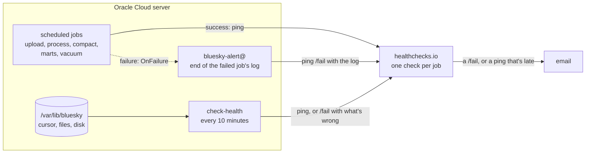

# Monitoring

## Purpose

Until now, the only way to know something had broken was to go and look. The Jetstream stall on 27 October ([incident](../validation/incidents.md#jetstream-went-quiet-for-15-minutes-27-october)) only turned up because I happened to read the collector's log. Monitoring means an email when something breaks, and another when it's fixed.

## Goals and non-goals

Goals:

- An email within a minute when a job fails, with the end of its log.
- An email when something that should happen doesn't: a job that stops running, a stalled stream, or the whole server going down.
- Free, and small enough to read in one sitting.

Non-goals:

- Metrics dashboards (Grafana and the like). The public dashboard is the only one this project gets.
- Paging, on-call, escalation. It's one person's project; email is enough.
- Fixing things automatically, beyond systemd restarting the collector.
- Checking that the numbers make sense. The dbt tests already fail the marts build when they don't, and that failure alerts like any other.

## Design

There are two halves:

- **[healthchecks.io](https://healthchecks.io) is a dead man's switch.** It knows when each job should ping. It emails when a ping says the job failed, or when no ping arrives on time. Missing pings are what catch the cases where nothing runs at all: a timer that stopped, or a server that's down, which can't report on itself ([D-041](../decisions/engineering-decisions.md#d-041-alerts-come-from-outside-the-server)).
- **`check-health` reports what only the server can see**, every 10 minutes:

| Check | Fails when | Because |
|---|---|---|
| Newest event | the collector's cursor is more than 5 minutes behind the clock | the collector syncs its cursor every 5 seconds, so a stale cursor means it has stopped, or Jetstream has gone quiet |
| Upload backlog | a finished hour's file has waited more than 30 minutes to be uploaded | uploads run every 10 minutes |
| Processing backlog | an uploaded file has waited more than 2 hours to be processed | processing runs every hour |
| Disk | the disk is more than 80% full | it's 100 GB, and the collector can't write once it's full |

Its ping always carries a one-line summary ("newest event 2s old, 0 files to upload, 1 files to process, disk 14% used"). When something's wrong, the ping goes to `/fail` with what's wrong first. healthchecks.io puts the last ping's message in the email, so the alert says what broke.

**How a job reports.** Every scheduled service has two extra lines:

- `ExecStartPost=… ping-check bluesky-process`: runs only after the job succeeded, and pings its check.
- `OnFailure=bluesky-alert@%n.service`: when the job fails, systemd starts `bluesky-alert@bluesky-process.service`. That sends the last 40 lines of the job's log to the check's `/fail` URL.

A ping never fails a job. If healthchecks.io can't be reached, `ping-check` tries three times, logs a warning and exits 0.

**Pings use one key.** healthchecks.io gives a project a ping key, and each check a name (its slug), so a ping goes to `https://hc-ping.com/<ping key>/<check name>`. The key lives in `/etc/bluesky/monitor.env`, root only, like the AWS keys. It can't do anything but ping, but anyone with it could make checks look healthy, so it stays out of the repo.

**Cost alerts** were already there: the AWS budget emails at 80% of $10 spent in a month, and when the month is forecast to go over ([infrastructure](infrastructure.md#aws)).

## The checks on healthchecks.io

All times UTC. The grace period is how late a ping can be before it counts as missing.

| Check | Schedule (cron) | Grace | Pinged by |
|---|---|---|---|
| `bluesky-check` | `5-55/10 * * * *` | 15 min | `bluesky-check.timer` |
| `bluesky-upload` | `*/10 * * * *` | 20 min | `bluesky-upload.service` |
| `bluesky-process` | `20 * * * *` | 45 min | `bluesky-process.service` |
| `bluesky-compact` | `45 3 * * *` | 2 h | `bluesky-compact.service` |
| `bluesky-marts` | `30 4 * * *` | 1 h | `bluesky-marts.service` |
| `bluesky-vacuum` | `45 5 * * *` | 1 h | `bluesky-vacuum.service` |

Compaction gets the longest grace, because the monthly run reaches everything and it can wait for the hourly job's lock. The collector has no check of its own: it runs all the time instead of on a schedule, and `bluesky-check` covers it through the newest event.

## How soon an alert comes

| What breaks | Email after |
|---|---|
| A scheduled job fails | under a minute |
| The collector stops, or Jetstream goes quiet | 5 to 15 minutes |
| A timer stops starting its job | the job's grace period after its next run was due |
| The server goes down | 15 to 25 minutes, from `bluesky-check` |
| Monthly spend reaches $8 | when AWS next updates the budget, a few times a day |

With this in place, the 27 October stall would have sent an email between 08:05 and 08:15, and a recovery email about ten minutes after the stream came back.

## Answering an alert

| Alert | First look |
|---|---|
| A job failed | The log lines in the email. Then `sudo journalctl -u <job> --no-pager \| tail -50` |
| Newest event too old | `sudo journalctl -u bluesky-collect --no-pager \| tail -20`. If it's connected with 0 events a minute, it's Jetstream; it usually comes back by itself. If the collector isn't running, `sudo systemctl status bluesky-collect` |
| Files waiting to upload or process | The upload or process job's log; usually credentials or AWS |
| Disk | `sudo du -sh /var/lib/bluesky/*` |
| `bluesky-check` late | The server is down or unreachable. Check it in the Oracle Cloud console |

Anything that cost data or broke a stated promise goes into [incidents](../validation/incidents.md).

## Limits

- **Only total stalls are caught.** If Jetstream kept sending events but fewer of them, the newest event would still be fresh. A check on events per hour against the usual 850,000 or so would catch it, once there's enough history to say what usual is.
- **If healthchecks.io itself is down, there are no alerts.** Jobs carry on as normal, since a ping never fails a job.
- **The processing backlog check is late by design.** Two hours means one missed hourly run doesn't alert, since a failed run already has.

## Cost

Free. healthchecks.io's free plan has 20 checks, and this uses 6.
