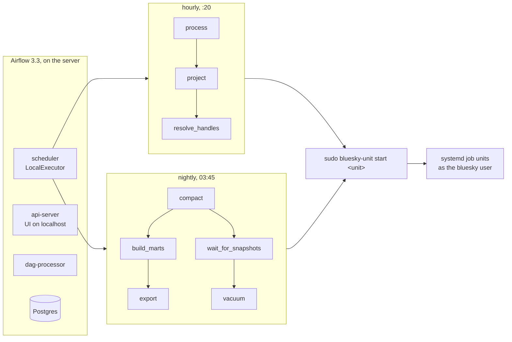

# Orchestration

## Purpose

The hourly and nightly jobs depend on each other. The projections need the event store's new hour, the marts need compaction to have finished, the report needs the marts, and the vacuum needs compaction's snapshots to have expired. Run on fixed timers, each job could only assume the one before it had finished. Airflow runs them as DAGs instead: each task starts when the tasks it depends on have succeeded, failures are retried, every run is recorded, and past days of the marts can be rebuilt on demand.

## Goals and non-goals

Goals:

- Every job starts only after the jobs it depends on have succeeded.
- Retries for transient failures, and a record of every run with its log.
- Rebuilding the marts for any range of past days, without touching the other jobs.
- No change to how the jobs are secured: their AWS keys, sandboxing, lake lock and monitoring stay as they are.

Non-goals:

- Moving collection, upload or the health check into Airflow. They protect the data and the alerting, so they keep running if Airflow is down.
- A distributed executor. Every task starts a job on the same server; the LocalExecutor is enough.

## Design



| DAG | Schedule (UTC) | Tasks |
|---|---|---|
| `hourly` | every hour at :20 | `process` loads the event store, then `project` folds the projections, then `resolve_handles` looks up changed handles |
| `nightly` | 03:45 | `compact`, then `build_marts` and `export`. In parallel, `wait_for_snapshots` holds the vacuum until 70 minutes after compaction finished, then `vacuum` |
| `rebuild_marts` | when triggered | One `rebuild_day` task per day in the range, one at a time, then a build for today and the export |

The tables keep an hour of snapshots, and the vacuum can only delete files that no snapshot refers to. Waiting 70 minutes after compaction, rather than starting at a fixed time, means the vacuum always removes what compaction replaced, however long compaction took.

## How a task runs a job

Each task is a `SystemdUnitOperator`, a small operator in `orchestration/dags/systemd_unit.py`. It starts the job's systemd unit, waits for it to finish, copies that run's log from the journal into the task log, and fails the task if the unit failed. The jobs themselves are unchanged ([D-043](../decisions/engineering-decisions.md#d-043-airflow-starts-the-systemd-units-it-doesnt-run-the-jobs)):

- They still run as the `bluesky` user, with their AWS keys read by systemd from root-only files. Airflow never holds an AWS key.
- They keep their sandbox, the lake lock, and their healthchecks.io pings and failure emails.

**Starting a unit.** The `airflow` user can run exactly one command as root, `/usr/local/sbin/bluesky-unit`, through sudo. The script takes `start` or `stop` and one unit name, rejects anything outside letters, digits and `@.-`, and only accepts the project's job units: `bluesky-process`, `-project`, `-handles`, `-compact`, `-vacuum`, `-export` and `bluesky-marts@<date>`. It can't touch the collector, the uploader, the health check or any other unit on the server.

**Stopping.** If a task exceeds its time limit or is cleared while running, the operator stops the unit, and the next try starts it again. Every job is safe to run again, so retries need no special handling.

## Rebuilding past days

`bluesky-marts@.service` is a template: the date in its name is passed to dbt as `end_date`, and dbt rebuilds the two days before it. The nightly run uses its own date. To rebuild a range, trigger `rebuild_marts` with `first_day` and `last_day`, from the UI or the CLI:

```
af dags trigger rebuild_marts --conf '{"first_day": "2026-10-25", "last_day": "2026-10-28"}'
```

(`af` runs Airflow's CLI as the `airflow` user; see [operating it](#operating-it).)

Some marts are rebuilt in full on every run, and a run for a past day builds them only up to that day. So after the past days, the DAG runs a normal build for today, then exports the report's numbers.

The hourly jobs don't need backfills. Each reads whatever is new since its own last run, so a missed or failed run is caught up by the next one, and `catchup` is off for every DAG.

## Monitoring

The healthchecks.io checks are unchanged in number. Each job unit still pings its check: `bluesky-project` and `bluesky-handles` report to `bluesky-process`, and `bluesky-export` and every dated `bluesky-marts@…` unit report to `bluesky-marts` ([monitoring](monitoring.md#the-checks-on-healthchecksio)). If Airflow stops scheduling, the hourly pings stop, and `bluesky-process` alerts within the hour.

## Failure handling

| What happens | Result |
|---|---|
| A job fails | Its unit emails the end of its log at once, and Airflow retries the task: twice for the hourly jobs, once for the nightly ones. The tasks after it don't run |
| Compaction runs long | The marts wait for it; the vacuum waits 70 minutes after it |
| An hourly run waits for the lake lock while compaction holds it | It waits, within a 50-minute limit, so a stuck run never overlaps the next one |
| Airflow is down | Collection, upload and the health check carry on. The hourly and nightly jobs don't run until it's back, then the next runs catch up; healthchecks.io emails about the missing pings |
| The server reboots | Postgres and the three Airflow services start on boot |

## Setup on the server

Airflow runs in its own virtual environment, installed with Airflow's pinned constraints so its dependencies never conflict with the project's. Its database is a local Postgres reached over the Unix socket, so it needs no password. The UI is reached with `ssh -L 8080:127.0.0.1:8080` and the generated admin password in `/var/lib/airflow`.

| File in the repo | Installed as |
|---|---|
| `deploy/airflow/airflow.env` | Read by the Airflow units from the checkout |
| `deploy/airflow/airflow-secrets.env.example` | `/etc/bluesky/airflow-secrets.env`, with keys generated on the server |
| `deploy/airflow/airflow-*.service` | `/etc/systemd/system/` |
| `deploy/airflow/bluesky-unit` | `/usr/local/sbin/bluesky-unit`, owned by root |
| `deploy/airflow/sudoers` | `/etc/sudoers.d/bluesky-airflow` |

## Operating it

Airflow's commands run as the `airflow` user, with its settings and keys. On the server, this shell function does that:

```
af() { sudo systemd-run --quiet --wait --pipe --uid=airflow --gid=airflow -p EnvironmentFile=/opt/bluesky-stream-analytics/deploy/airflow/airflow.env -p EnvironmentFile=/etc/bluesky/airflow-secrets.env /opt/airflow/venv/bin/airflow "$@"; }
```

| To | Run |
|---|---|
| See the DAGs, and whether any failed to load | `af dags list` and `af dags list-import-errors` |
| Pause or resume a DAG | `af dags pause nightly`, `af dags unpause nightly` |
| Run a DAG now | `af dags trigger hourly` |
| Rebuild past days of the marts | `af dags trigger rebuild_marts --conf '{"first_day": "2026-10-25", "last_day": "2026-10-28"}'` |
| Open the UI | `ssh -L 8080:127.0.0.1:8080 ubuntu@<server>` from the laptop, then `http://localhost:8080`. The admin password is in `/var/lib/airflow/simple_auth_manager_passwords.json.generated` |
| Run a job by hand, outside Airflow | `sudo systemctl start bluesky-compact.service`, exactly as Airflow starts it |

## Testing

- **In CI**, a separate job installs Airflow 3.3.2 with its constraints and checks that the DAGs load without errors, that their tasks depend on each other as described here, and that the operator starts the right unit, copies its log, fails when the unit fails, and stops the unit when killed.
- **In the main suite**, the `bluesky-unit` script is tested against units it must refuse, including names that try to smuggle in a second unit with a space or a newline, and against every unit it must allow.
- **End to end**, the DAGs were run with `airflow dags test` against stand-in `sudo`, `systemctl` and `journalctl` commands, which checked the unit names each task starts, including the dated marts units.

## Cost

Free. Airflow, its database and its three services run on the existing server, within about 1.5 GB of its 12 GB of memory.
