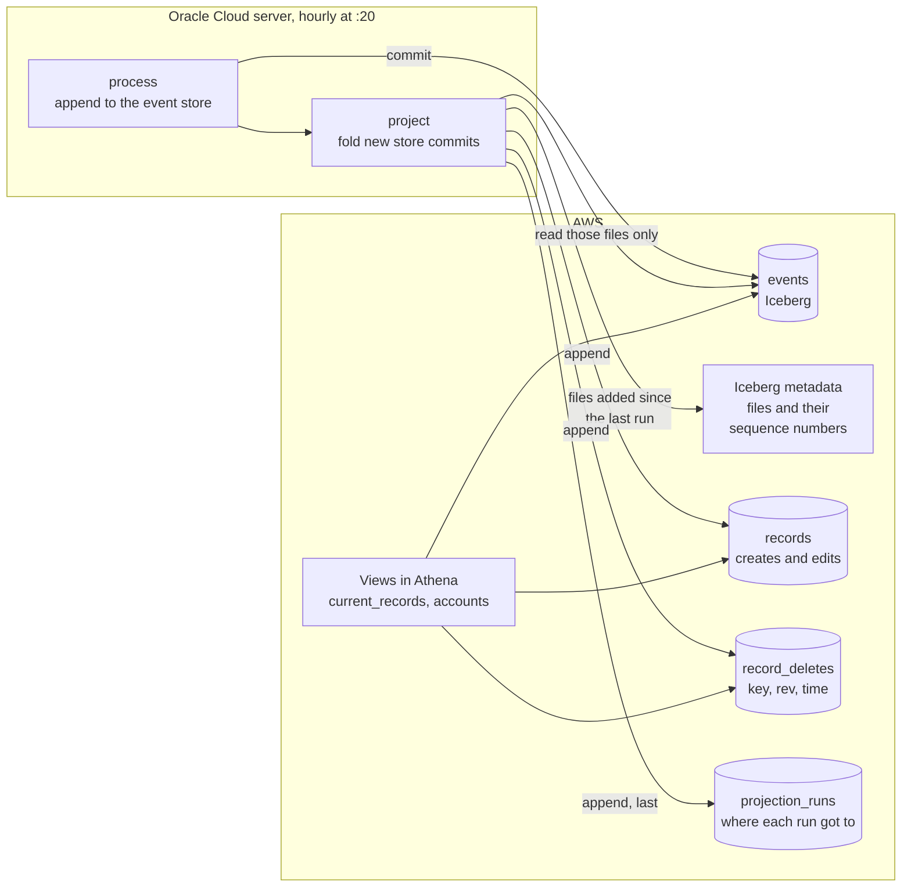

# Projections

## Purpose

The [event store](event-store.md) says what happened: a like was created, then deleted. The projections say what's true now: which likes, posts, reposts, follows and blocks exist, at their latest version, with deleted ones gone. They're the read model the metrics and the dashboard are built on, and like everything after the raw log, they can be thrown away and rebuilt from the store.

## Goals and non-goals

Goals:

- A deleted record disappears from every query of current state at the next hourly run.
- The same answer however many times an event is folded in, and in whatever order. Rewinds, reruns after a crash and backfills need no special handling.
- An hourly run costs the same whatever size the tables have grown to.
- Deletes keep nothing about the deleted record except its key.

Non-goals:

- Physically removing deleted rows every hour. That's nightly [compaction](compaction.md), which also sets the deadline by which deleted data leaves S3.
- Record content. Like the store, there's no post text, only reply links and languages.
- Removing the records of deleted accounts. That needs a pass over every record of an account and isn't implemented: a deleted account's handles are removed, but its records remain.

## Design

1. **Find what's new.** Every commit to the event store gets the next sequence number in Iceberg's metadata, and every data file records the one it was added in. `project` asks the metadata for the store's files, keeps those with a sequence number above the last one in `projection_runs`, and groups them by commit, oldest first. Events only ever arrive as appends. Compaction also commits to the store when it redacts deleted records and rewrites files, but those commits add no events, so `project` reads the store's metadata through Glue and skips every commit that isn't an append ([D-034](../decisions/engineering-decisions.md#d-034-deleted-records-are-redacted-in-the-event-store)).
2. **Read only those files.** One commit's files at a time, and only the columns the fold needs, straight from S3. Only commits of the five record types below are kept.
3. **Fold.** Creates and edits become rows for `records`. Deletes become markers for `record_deletes`: the account, record type, key, `rev` and time, nothing else.
4. **Append.** `records` first, then `record_deletes`, then one row in `projection_runs` saying which commit it reached. Nothing already in the tables is read or changed.
5. **Read through views.** `current_records` keeps each record's highest-`rev` version, and drops it if a marker has a higher `rev`.

If the job dies before the run is logged, the next run folds the same commit again. That appends rows identical to ones already there, and the view returns each record once regardless.

## Why it's correct in any order

Each record's versions are ordered by `rev`, the account's repo revision, which only ever goes up. The rule only looks at the highest `rev` of each kind, and the highest of a set doesn't depend on the order its members arrived in:

| Arrives in this order | Highest create/edit `rev` | Highest delete `rev` | Current? |
|---|---|---|---|
| create (1), delete (2) | 1 | 2 | No |
| delete (2), create (1) | 1 | 2 | No |
| create (1), edit (2) | 2 | none | Yes, as edited |
| edit (2), create (1) | 2 | none | Yes, as edited |
| create (1), delete (2), create again with the same key (3) | 3 | 2 | Yes |
| delete (2) of a record created before collection started | none | 2 | No, only a marker |

Keeping a marker rather than removing the row is what makes the second line work: a create that arrives after its delete, say from a backfill, is outranked instead of bringing the record back.

## The tables

All three are Iceberg v2 tables in `bluesky_store`.

**`records`**: one row per version of a record, partitioned by record type and the day the record was created. Day partitions let compaction rewrite only the last few days, where most deletes land ([D-033](../decisions/engineering-decisions.md#d-033-compaction-is-tiered-by-record-type-and-age-to-fit-the-budget)).

| Column | What it holds |
|---|---|
| `did`, `collection`, `rkey` | The record's key: account, record type, record key |
| `rev` | The repo revision of this version |
| `record_time` | When the record was created, decoded from its key (see below) |
| `event_time` | When this version was seen |
| `operation` | `create` or `update` |
| `subject_did`, `subject_collection`, `subject_rkey` | What a like or repost points at; for follows and blocks, the account |
| `reply_parent_uri`, `reply_root_uri`, `langs` | For posts |

**`record_deletes`**: one row per delete, partitioned by record type and the month of the delete. Each run only writes to the current month however old the deleted records are, so deletes don't scatter small files across old partitions.

**`projection_runs`**: one row per folded commit: when, the sequence numbers from and to, files read, events folded, versions and markers added, and the time of the oldest delete folded. The gap between that and the run is the longest a deleted record stayed visible.

**Views**, created in Athena from `sql/views/`:

| View | What it is |
|---|---|
| `current_records` | Every record that exists now, at its latest version |
| `accounts` | Every account seen in an identity or account event, with its latest handle and status. Those events are about 0.1% of the store, so this reads it directly rather than keeping a table ([D-032](../decisions/engineering-decisions.md#d-032-accounts-are-a-view-over-the-event-store)) |

## Record types

`app.bsky.feed.post`, `app.bsky.feed.like`, `app.bsky.feed.repost`, `app.bsky.graph.follow` and `app.bsky.graph.block`. Other types, from Bluesky or other apps on the network, stay in the event store but aren't projected.

## Creation time from the record key

These record types use TIDs as keys: 13 characters of 5 bits each, in a sortable base32 alphabet, holding a 64-bit number made of a 0 bit, 53 bits of microseconds since 1970 and 10 bits of clock id. The last 2 characters are exactly the clock id, so decoding the first 11 gives the creation time to the microsecond, in SQL, with no lookup.

That's what makes partitioning by creation day possible: even a delete of a like from 2024, whose create was never seen, has a known creation time. A key that isn't a TID, or decodes to before 2022 or to after the event was seen, gets no `record_time` and lands in a partition of its own. On real data that's about 0.02% of records, mostly posts, and nearly all of them are TID-shaped keys that decode to 1970 or to centuries from now, from apps that don't build keys from the clock ([details](../validation/testing.md#the-projections-on-real-data)).

## Failure handling

| What happens | Result |
|---|---|
| The job dies before logging a run | The next run folds that commit again. The duplicate rows don't change any view |
| The event store load fails | `project` doesn't run that hour (it runs after `process` in the same service). The next run catches up on every commit since |
| Compaction redacts or rewrites store files | Those commits aren't appends, so the run skips them; the events in them were folded when they first arrived |
| An equality delete file appears in the event store | The run stops with an error. Nothing writes them, and reading files directly can't follow them |
| The tables are lost or need a fix | Drop them and run `project`: with no runs logged, it folds every commit from the first |

## Cost

- Reading: only the commits added since the last run, about 40 MB of the store an hour. The server is outside AWS, so this counts as data leaving AWS. About 30 GB a month is well inside the 100 GB free each month ([D-029](../decisions/engineering-decisions.md#d-029-projections-are-appended-to-not-updated-in-place)).
- Writing to S3 is free, and storage grows by roughly the size of the commit columns of the store.
- The views run in Athena and are billed by bytes scanned.
