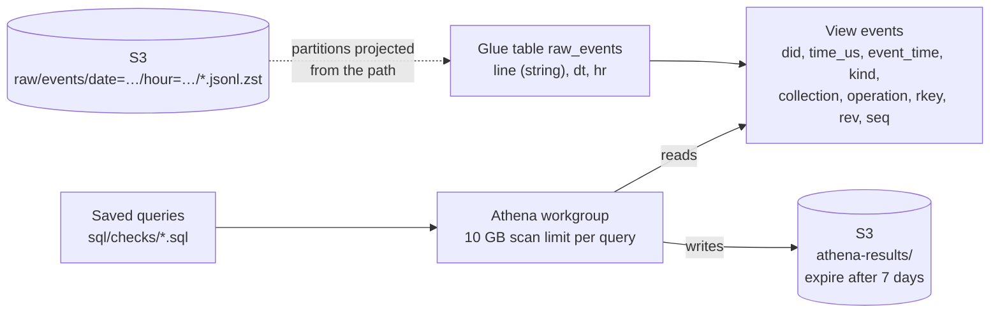

# Query layer

## Purpose

Athena runs SQL directly on the raw hourly files in S3, with nothing loaded or copied first. That's for checking the collector's output: how many events arrived, whether any minute is missing, and how many duplicates the resume rewinds created. The [event store](event-store.md) table `bluesky_store.events` is queried through the same workgroup. It's typed and columnar, so it's the one to use for anything else.

## Goals and non-goals

Goals:

- Query every uploaded hour as soon as it lands, with no crawler or partition registration to run.
- Keep the raw table exactly as faithful as the files: no field dropped or reinterpreted.
- Cap what any single query can cost.

Non-goals:

- Removing duplicates or applying deletes.
- Typed, columnar tables. Every query here parses JSON, which is fine for exploring and too slow to build metrics on.

## Design

1. **Raw table.** `raw_events` has one column, `line`, holding each line of the `.jsonl.zst` files exactly as stored. Athena decompresses zstd on the fly, based on the `.zst` extension.
2. **Partition projection.** `dt` and `hr` come from the folder names. The table describes the pattern (`date=yyyy-MM-dd/hour=00..23`) and Athena computes which folders to read from the query's filter, so a new hour is queryable as soon as its file is uploaded. A filter like `WHERE dt = '2026-10-24' AND hr = '19'` reads only that hour.
3. **View.** `events` parses each line once and exposes the fields used for exploring. `event_time` is the event's `time_us` as a UTC timestamp. Duplicates are kept on purpose, so the checks can measure them.
4. **Workgroup.** All queries run in the `bluesky-stream-analytics` workgroup. It enforces a per-query scan limit, writes results to `athena-results/` (deleted after 7 days), and can't be overridden by a client.

## Saved queries

The SQL lives in `sql/` and is loaded into Athena as saved queries by Terraform.

| Query | What it answers |
|---|---|
| `create-events-view` | Creates or updates the `events` view. Run once, and again after the view changes |
| `events-per-hour` | Events per stored hour and the time span each covers |
| `missing-minutes` | Minutes with no events between the first and last event collected |
| `duplicates` | Rows stored versus distinct events, per hour |
| `event-mix` | Share of events by kind, record type and operation |
| `store-vs-raw` | For yesterday, distinct raw events against rows in the event store, per hour. Every hour should match |

An event is identified by its account, record type, record key, revision and operation for commits, and by its sequence number for identity and account events. `time_us` is not unique, so it isn't part of the key.

## Cost

Athena charges for the bytes it reads, and the files are compressed, so it reads roughly 200 to 250 MB per hour of data. A query over a full day reads about 5 to 6 GB. The workgroup stops any query that would read more than 10 GB.
