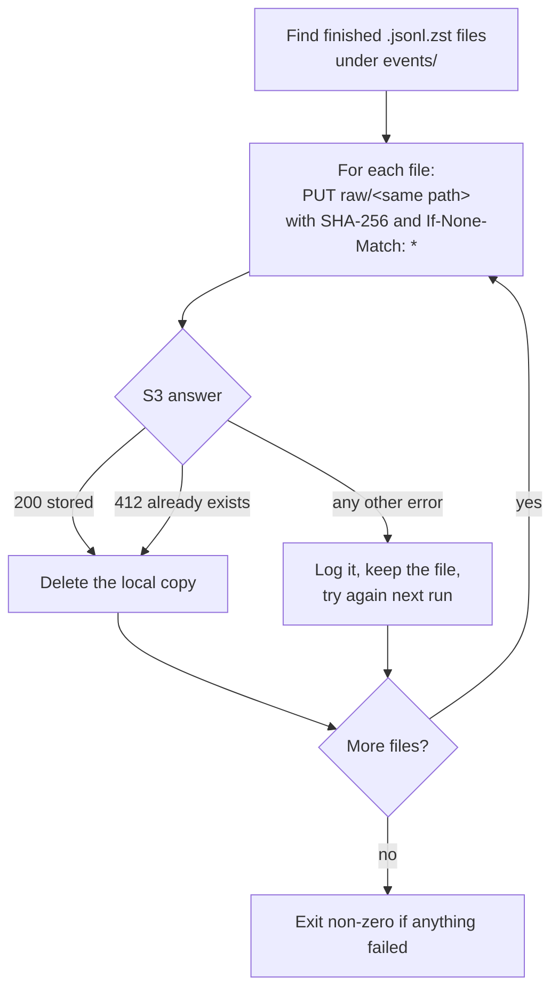

# Uploader

## Purpose

`upload` moves finished hourly files from the server's disk to S3 and frees the space. It runs every 10 minutes from a systemd timer, separately from the collector, so an S3 or credentials problem never stops collection.

## Goals and non-goals

Goals:

- Never delete a local file before S3 has an intact copy of it.
- Make running it again always safe: no duplicate uploads, no overwrites.
- Keep the S3 layout identical to the local one.

Non-goals:

- Uploading files that are still being written.
- Reading, listing or deleting anything in S3. The server's credentials can only upload.

## Design

1. **Find.** Every `.jsonl.zst` under `events/`. `.open` and `.zst.tmp` files are never touched.
2. **Upload.** Each file goes to `raw/` plus its path under the data folder, for example `raw/events/date=2026-10-24/hour=16/<name>.jsonl.zst`. The request carries the file's SHA-256, which S3 recomputes; a mismatch rejects the upload.
3. **Never overwrite.** The request uses `If-None-Match: *`, so it only succeeds if the key doesn't exist yet. An "already exists" answer means an earlier run uploaded the file but stopped before deleting it. File names are unique per collector run and finished files never change, so the same name means the same file, and it counts as done.
4. **Delete.** The local copy is removed only after one of those two answers.
5. **Report.** A failure on one file is logged and the rest carry on. The command exits with an error if anything failed, so it shows up in the systemd journal.

## Permissions

The server's IAM user has one permission, `s3:PutObject` under `raw/`. That's enough for a checksummed, conditional upload, and nothing more: leaked keys can't read, list or delete data.
